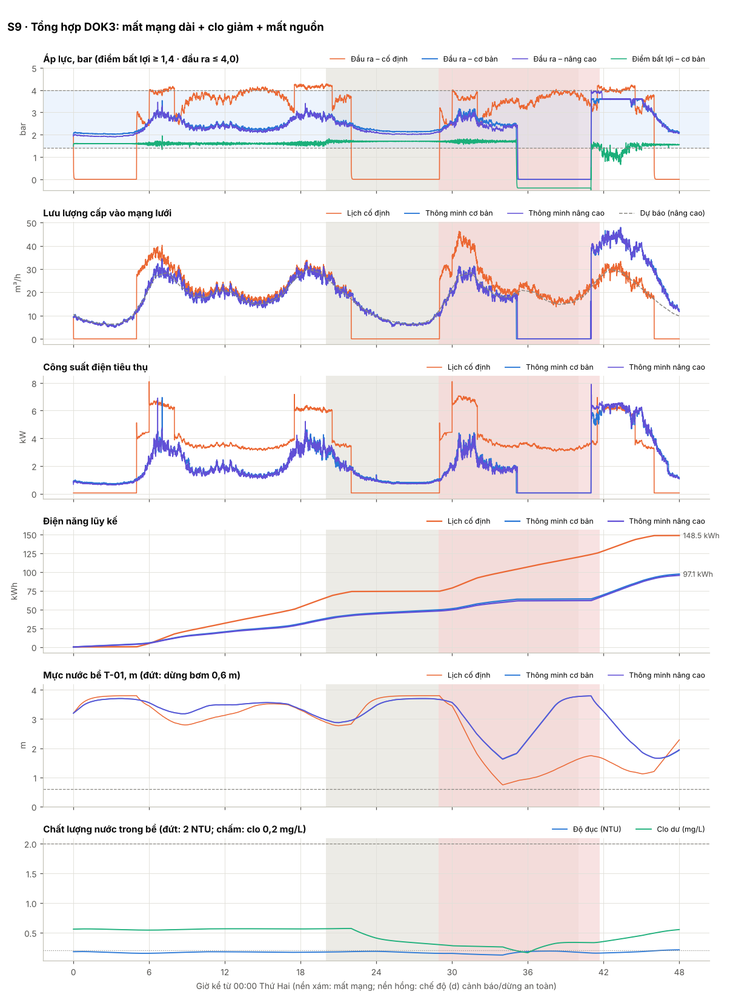

# SYSTEM · Giám sát và mô phỏng 3D trạm bơm tăng áp thông minh

Mô phỏng tương tác hệ thống điều khiển tự động cho một trạm bơm tăng áp nhỏ **không người trực** phục vụ khu dân cư,
dành cho sinh viên các học phần Tự động hóa, Hệ thống nhúng/IoT và Kỹ thuật cấp thoát nước.

- **Màn Mạng lưới (mở đầu)**: trung tâm giám sát của SYSTEM quản lý và giám sát tự động **16 trạm bơm giả lập ở Hà Nội** – bản đồ
  Hà Nội, danh sách trạm, báo động & dòng "hệ thống tự xử lý", hiệu quả toàn mạng và phát hành kịch bản tập trung. Mỗi trạm là một
  mô phỏng thật (sự cố rải trên nhiều trạm); nhấp một trạm để xuống chi tiết 3D / HMI như bên dưới. Xem [08](docs/08-mang-luoi-ha-noi.md).
- **Bản web 3D toàn màn hình** (Three.js, chạy trong trình duyệt) gồm:
  - mô hình trạm bơm: bể chứa, 2 bơm biến tần, đường ống, van, đồng hồ áp lực, cảm biến lưu lượng, mức nước, chất lượng nước (clo dư, độ đục, pH), bình tích áp;
  - **tủ động lực hiện trạng CP-01** và **tủ mới CP-02** (mini PC chạy edge gateway, I/O từ xa, router 4G, UPS, màn HMI);
  - **thẻ chỉ số trực tiếp** (áp đầu ra, áp điểm bất lợi, lưu lượng, mức bể, công suất, chất lượng nước, quyền điều khiển) nổi trên cảnh 3D;
  - **thanh chức năng** bên phải: Biểu đồ, So sánh với lịch cố định, Báo động, Giám sát, Thiết bị, Sự cố, Kịch bản, Trung tâm, Nhật ký, Bài học, Điều khiển TAY, Camera, Hiển thị;
  - **điều khiển ngay trong 3D**: bấm vào bơm hoặc van MV-02 để mở bảng điều khiển gắn với thiết bị (chạy/dừng, đặt tần số, đóng/mở van, liên động, lệnh cuối); ở chế độ TAY có nút chạy/dừng trên từng bơm và viền báo chế độ TAY;
  - tiêm sự cố, trình soạn kịch bản cho học viên, bảng điều khiển trung tâm cho 4 trạm.
- **Phân biệt rõ ba nhóm thiết bị:**
  - *hiện trạng nhà máy*: bơm, biến tần, bể, van, phao, tủ động lực;
  - *giải pháp đưa vào*: mini PC tiếp nhận – xử lý – điều khiển tín hiệu tại chỗ, I/O, cảm biến, 4G, UPS, rơ-le watchdog;
  - *khuyến nghị*: nên có để vận hành trơn tru.

  Nút **Hiển thị** (lọc màu theo nhóm trong cảnh 3D), mục **Thiết bị** và tùy chọn "không lắp" cho thấy bằng số liệu mỗi thiết bị đáng giá bao nhiêu. Xem [07](docs/07-hien-trang-va-giai-phap.md).
- **Màn hình HMI kiểu SCADA nhà máy** (giống các màn WinCC / InTouch đang dùng ở nhà máy nước): thanh tiêu đề có đèn truyền thông và bộ đếm báo động, dòng báo động có nút xác nhận, 7 màn hình (Tổng quan P&ID, Bơm – biến tần, Chất lượng nước, Xu hướng, Báo động, Nhật ký, Thông số), bảng điều khiển bật lên (faceplate) với bước xác nhận lệnh, hai giao diện Tối/Sáng. Có hai vị trí vận hành:
  - *Tại trạm · HMI-01*: dữ liệu trực tiếp từ gateway, lệnh đi thẳng;
  - *Trung tâm · SCADA*: chỉ thấy dữ liệu máy chủ nhận qua MQTT, lệnh có thời hạn.

  Cả hai đều có điều khiển bơm TAY (chạy/dừng, đặt tần số, đóng/mở van), quyền tại chỗ ưu tiên; quyền từ xa tự trở về tự động khi mất mạng.
- **Lõi mô phỏng Python** (chỉ thư viện chuẩn): chạy kịch bản không giao diện, xuất bảng KPI và biểu đồ, kiểm thử tự động,
  chấm bài học viên. Lõi JavaScript của bản web là bản chuyển đổi một-một, được kiểm thử đối chiếu cho cùng kết quả.



## Cài đặt và chạy

Yêu cầu: Python ≥ 3.9. Trình duyệt hiện đại có WebGL (Chrome, Edge, Firefox, Safari). Node.js chỉ cần nếu muốn chạy kiểm thử
đối chiếu Python–JavaScript.

```bash
git clone <địa chỉ kho> simulator-trambom
cd simulator-trambom
python -m pip install -r requirements.txt   # matplotlib (biểu đồ báo cáo) và pytest (kiểm thử)
```

### Bản web 3D

```bash
python -m trambom web
```

Lệnh này chạy máy chủ web tĩnh tại `http://127.0.0.1:8000/web/` và mở trình duyệt. Có thể dùng bất kỳ máy chủ tĩnh nào
**phục vụ từ thư mục gốc của kho** (bản web đọc cấu hình chung ở `config/`), ví dụ `python -m http.server 8000` rồi mở
`/web/`. Không mở trực tiếp `index.html` bằng `file://` vì trình duyệt chặn ES module. Three.js được đóng gói sẵn trong
`web/vendor/` nên chạy được khi không có Internet (phông chữ sẽ dùng phông hệ thống).

Mặc định mở màn **Mạng lưới** (Hà Nội, 16 trạm). Mở thẳng một trạm: `http://127.0.0.1:8000/web/#ST-05` (3D) hoặc `#ST-05-hmi`.
Mở thẳng một kịch bản bài học (chạy trên ST-01): `#S4-advanced`; màn hình HMI của bài: `#S12-basic-hmi`. Nút
**Mạng lưới | 3D | HMI** trên thanh trên cùng chuyển qua lại ba giao diện; bấm logo SYSTEM để về màn Mạng lưới.

Cách dùng giao diện:

| Muốn | Thao tác |
|---|---|
| Xem toàn mạng, chọn một trạm | Màn **Mạng lưới**: nhấp marker trên bản đồ (hoặc dòng trong danh sách), **Mở mô phỏng 3D** / **Mở HMI** |
| Đổi trạm khi đang xem chi tiết | Ô chọn trạm và nút ‹ › trên thanh trên cùng |
| Chạy, tạm dừng, tua nhanh, đổi kịch bản | Thanh trên cùng (màn hình hẹp: nút ☰) |
| Xem biểu đồ, so sánh với lịch cố định | Nút **Biểu đồ** / **So sánh** trên thanh chức năng (tấm trượt từ dưới lên, cỡ S/M/L); bấm một thẻ chỉ số để mở đúng biểu đồ đó |
| Điều khiển bơm, van trong 3D | Bấm vào bơm/van (hoặc nút **Điều khiển TAY**) → bảng điều khiển nổi; ở TỰ ĐỘNG các nút lệnh bị khóa cho tới khi chuyển TAY |
| Xem thông số một thiết bị bất kỳ | Bấm vào thiết bị trong 3D hoặc trong mục **Thiết bị** |
| Đổi góc nhìn, nhãn, lọc nhóm thiết bị | Nút **Camera**, **Hiển thị** |
| Đóng cửa sổ đang mở | Phím **Esc** (đóng lần lượt từ cửa sổ mở sau cùng) |

Triển khai cho cả lớp: bật GitHub Pages (hoặc chép cả kho lên một máy chủ web tĩnh bất kỳ) rồi mở đường dẫn `…/web/`.
Không cần máy chủ ứng dụng: toàn bộ mô phỏng chạy trong trình duyệt của học viên.

Muốn gửi một file duy nhất (LMS, email): `npm install --no-save esbuild` rồi
`node tools/build_single_page.mjs dist/tram-bom-st01.html` (Three.js tải từ CDN), hoặc thêm `--local` và chép kèm
`web/vendor/` để chạy không cần Internet.

### Mô phỏng Python (không giao diện)

```bash
python -m trambom list                       # danh sách kịch bản
python -m trambom thresholds                 # bảng ngưỡng tham số
python -m trambom run S3 --level advanced    # chạy một kịch bản, in bảng KPI + diễn biến, lưu out/S3_advanced.png
python -m trambom compare                    # chạy mọi kịch bản ở cả hai mức → docs/ket-qua/README.md + hình
python -m trambom network --hours 24         # 4 trạm trong mạng lưới, bảng điều hành tổng quát
python -m trambom check-student student/kich_ban_nguong.py   # chấm kịch bản theo ngưỡng của học viên
python -m trambom options                    # so sánh "có lắp / không lắp" từng thiết bị → docs/ket-qua/whatif.md
python -m trambom run S5 --off PT-102        # chạy kịch bản khi bỏ bớt thiết bị (PT-102, FT-100_pulse, AIT-201/202/203, SMS, VFD_PID_fallback)
```

### Kiểm thử

```bash
python -m pytest -q
```

Gồm kiểm thử mô hình vật lý (đường đặc tính, luật tương tự, bảo toàn khối lượng, van an toàn), gateway (phát hiện mất mạng,
nén bộ đệm không mất dữ liệu, lệnh hết hạn, từ chối kịch bản sai, dừng an toàn, biểu quyết cảm biến), hợp nhất xung đột,
mọi kịch bản, mẫu bài học viên, đối chiếu Python–JavaScript và mạng lưới Hà Nội (dữ liệu `hanoi.json`, sự cố hiện đúng trạm; cần Node.js).

## Bốn chế độ vận hành được mô phỏng

| Chế độ | Diễn biến | Kịch bản |
|---|---|---|
| (a) Bình thường có kết nối | Áp đặt theo lưu lượng + PI biến tần, ghép/tách và luân phiên bơm, dừng khi mức thấp; đo xa 10 s | S1, S10 |
| (b) Mất mạng – tự vận hành | Phát hiện sau 60 s không có ACK nhịp tim; chạy kịch bản đã lưu, cộng biên áp an toàn, lưu đệm và nén dữ liệu, SMS dự phòng | S2, S9 |
| (c) Đồng bộ khi có mạng lại | Bắt tay đồng bộ, hợp nhất 3 chiều tham số (bảo thủ cho tham số an toàn), lệnh hết hạn bị hủy, phát lại bộ đệm, quay lui kịch bản lỗi | S3, S3b, S9 |
| (d) Cảnh báo và dừng an toàn | Độ đục/clo/pH vượt QCVN → dừng bơm, đóng van đầu ra, chờ đặt lại; áp cao → giới hạn tần số, áp rất cao → cắt bơm; chống chạy khô | S4, S5, S6, S7, S8, S9 |
| Mini PC ngừng (watchdog) | Rơ-le watchdog nhả sau 5 s (trước khi I/O hết chờ ở 10 s) → biến tần của bơm đang chạy giữ 3,0 bar bằng PID nội; mất dừng an toàn chất lượng, ghép bơm, đo xa; khởi động lại → theo dõi 60 s rồi tiếp quản, đồng bộ (c) | S11 |
| Điều khiển TAY từ xa / tại chỗ | Chạy/dừng bơm, đặt tần số, đóng/mở van; quyền tại chỗ ưu tiên; quyền từ xa có hạn và tự hủy khi mất mạng (quyền tại chỗ thì không); lớp an toàn vẫn ưu tiên | S12 |

## Kết quả chính (từ `python -m trambom compare`)

<!-- KQ-START -->
Một tuần vận hành bình thường (kịch bản S10, cùng nhu cầu cho cả ba phương án):

| Chỉ số | Lịch cố định | Thông minh – cơ bản | Thông minh – nâng cao |
|---|---:|---:|---:|
| Điện năng tiêu thụ (kWh/tuần) | 527,4 | 317,1 | 307,5 |
| Suất điện năng (kWh/m³) | 0,174 | 0,105 | 0,102 |
| Áp lực ngoài dải (phút/tuần) | 5292 | 1 | 0 |
|   · điểm bất lợi < 1,4 bar | 3631 | 1 | 0 |
|   · đầu ra > 4,0 bar | 1661 | 0 | 0 |
| Thời gian đạt dải áp (%) | 47,5 | 100,0 | 100,0 |
| Số lần vi phạm chất lượng nước | 0 | 0 | 0 |
| Số lần khởi động bơm | 21 | 15 | 18 |
| Rò rỉ trên mạng lưới (m³) | 311 | 267 | 257 |
| Áp đầu ra lớn nhất (bar) | 4,39 | 3,68 | 3,73 |
| Tiết kiệm điện so với lịch cố định | – | 39,9 % | 41,7 % |
<!-- KQ-END -->

Bảng đầy đủ cho từng kịch bản: [docs/ket-qua/README.md](docs/ket-qua/README.md). Tóm tắt và phân tích:
[docs/06-so-sanh-dien-nang-chat-luong.md](docs/06-so-sanh-dien-nang-chat-luong.md).

## Tài liệu

| Tài liệu | Nội dung |
|---|---|
| [01 – Kiến trúc hệ thống](docs/01-kien-truc-he-thong.md) | Tầng cảm biến, edge gateway, truyền thông, máy chủ điều hành, tích hợp mạng lưới; chu kỳ quét; máy trạng thái 4 chế độ; thứ tự ưu tiên; các lớp bảo vệ |
| [02 – Thành phần và tham số](docs/02-thanh-phan-va-tham-so.md) | Tham số vật lý và dải làm việc từng thiết bị, bảng ngưỡng, phương trình mô hình (sinh tự động từ cấu hình) |
| [03 – Giao thức truyền thông](docs/03-giao-thuc-truyen-thong.md) | Chủ đề MQTT, thông điệp mẫu, phát hiện mất mạng, bộ đệm lưu-và-chuyển, bắt tay đồng bộ, quy tắc xử lý xung đột, REST API |
| [04 – Độ tin cậy khi mất kết nối](docs/04-do-tin-cay-mat-ket-noi.md) | Rủi ro, giới hạn của kịch bản đã lưu, chiến lược dự phòng, kế hoạch kiểm thử |
| [05 – Hướng dẫn học tập](docs/05-huong-dan-hoc-tap.md) | Mục tiêu Bloom/DOK, trình tự bài thực hành, phân hóa cơ bản/nâng cao, thang đánh giá |
| [06 – So sánh điện năng và chất lượng dịch vụ](docs/06-so-sanh-dien-nang-chat-luong.md) | Bảng tổng hợp lịch cố định so với điều khiển thông minh và phân tích |
| [08 – Mạng lưới Hà Nội](docs/08-mang-luoi-ha-noi.md) | Màn Mạng lưới: năm màn giám sát và điều hành nhiều trạm, 16 trạm giả lập ở Hà Nội, kịch bản sự cố H1, cấu trúc `config/hanoi.json`, giả định |
| [07 – Hiện trạng và giải pháp](docs/07-hien-trang-va-giai-phap.md) | Phân biệt thiết bị hiện trạng / giải pháp / khuyến nghị; hai tủ CP-01 và CP-02; cấu hình mini PC; danh sách I/O; phân cấp dự phòng khi mini PC hỏng; điều khiển tay từ xa và tại chỗ; giá trị từng thiết bị theo mô phỏng "có lắp / không lắp"; lộ trình triển khai |

## Cấu trúc thư mục

```
config/      station.json (tham số, ngưỡng, kịch bản điều khiển, tùy chọn lắp đặt `hardware`), scenarios.json,
             components.json (danh mục 56 thiết bị có phân loại hiện trạng / giải pháp / khuyến nghị) – dùng chung Python & web;
             hanoi.json (16 trạm giả lập ở Hà Nội + kịch bản sự cố H1) – chỉ bản web
trambom/     lõi mô phỏng Python: physics, sensors, gateway, control, safety, comms, server, baseline, kpi, engine, network
web/         bản web: index.html, assets/ (logo SYSTEM), css/, js/sim (lõi JS, fleet.js ghép mạng lưới), js/ui (cảnh 3D, HMI, màn Mạng lưới
             fleet*.js, biểu đồ, bảng), vendor/three (Three.js r160, MIT)
student/     mẫu bài tập (theo ngưỡng, dự báo, điều phối mạng lưới) và loi_giai/ (lời giải tham khảo cho giảng viên)
tests/       pytest
tools/       sinh tài liệu, chạy lõi JS bằng Node, định dạng JSON
docs/        tài liệu và kết quả so sánh
```

## Giả định và giới hạn của mô hình

- Mạng lưới được rút gọn thành một nút điểm bất lợi với tổn thất $rQ^2$, nhu cầu phụ thuộc áp (Wagner) và rò rỉ FAVAD; bồn mái
  của hộ dân được gộp thành một kho chứa 300 m³. Không mô phỏng búa nước, chất lượng nước trong mạng lưới, giá điện theo giờ.
- Các ngưỡng áp lực dịch vụ là giả định học tập; giới hạn chất lượng nước lấy theo QCVN 01-1:2018/BYT. Khi áp dụng thực tế cần
  đối chiếu văn bản hiện hành.
- Phương án lịch cố định là một cách vận hành thủ công điển hình (tắt bơm 22:00–05:00, van đẩy mở một phần, đổi bơm theo
  ngày). Có thể sửa `baseline` trong `config/station.json` để so sánh công bằng hơn với cách vận hành của đơn vị bạn.

## Giấy phép

Mã nguồn dùng cho mục đích giáo dục. Three.js thuộc bản quyền các tác giả three.js, giấy phép MIT (`web/vendor/three/LICENSE`).
