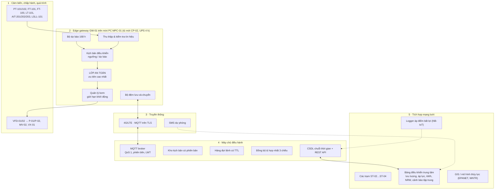
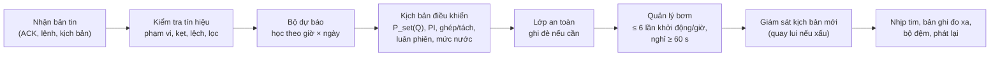
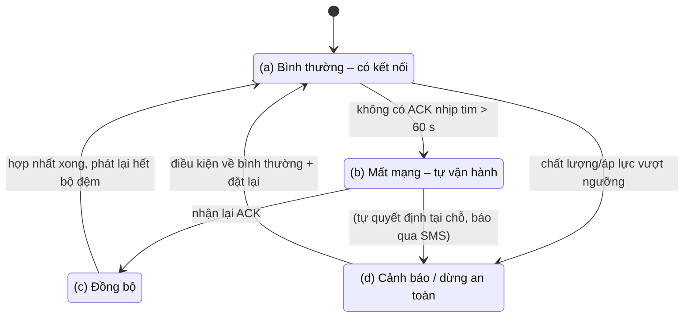

# Kiến trúc hệ thống điều khiển trạm bơm tăng áp thông minh

## 1. Bài toán và mục tiêu

Trạm bơm tăng áp ST-01 nhận nước sạch từ ống cấp thành phố vào bể chứa T-01, rồi bơm tăng áp vào mạng lưới phân phối của
khu dân cư A. Hiện trạm vận hành thủ công theo lịch cố định: bơm chạy 50 Hz trong các khung giờ định sẵn, van đẩy mở một phần
theo kinh nghiệm, tắt bơm ban đêm. Hậu quả, được định lượng trong [kết quả so sánh](ket-qua/README.md):

- áp lực dư thừa khi nhu cầu thấp (lãng phí điện, tăng rò rỉ) và mất áp khi tắt bơm hoặc giờ cao điểm;
- không phát hiện sự cố chủ động: lỗi bơm, nước nguồn đục, clo thấp, vỡ ống chỉ được biết khi công nhân đi kiểm tra
  hoặc dân phản ánh;
- không có dữ liệu cho điều hành mạng lưới.

Mục tiêu thiết kế: trạm **tự chủ** dựa trên dữ liệu cảm biến, vẫn vận hành an toàn khi mất kết nối với máy chủ điều hành,
và khi hai mục tiêu xung đột thì **an toàn và chất lượng nước được ưu tiên hơn tiết kiệm điện**.

## 2. Năm tầng của hệ thống

| Tầng | Vai trò | Trong mô phỏng |
|---|---|---|
| 1 · Cảm biến & chấp hành | Đo áp, lưu lượng, mức, chất lượng; điều khiển tốc độ bơm và van. Mạch cứng: phao LSLL-101 cắt bơm, van an toàn PSV-01 6 bar | `trambom/physics.py`, `trambom/sensors.py` (nhiễu, trễ, bão hòa 4–20 mA, lỗi kẹt/lệch/trôi/mất tín hiệu) |
| 2 · Edge gateway | Ra mọi quyết định điều khiển tại chỗ, chu kỳ 1 s. Không phụ thuộc máy chủ | `trambom/gateway.py`, `control.py`, `safety.py`, `comms.py` |
| 3 · Truyền thông | MQTT trên 4G; phát hiện mất mạng bằng nhịp tim; SMS cho báo động nghiêm trọng khi mất IP | `trambom/link.py` (độ trễ, mất gói, đứt kết nối) |
| 4 · Máy chủ điều hành | Nhận dữ liệu (chống trùng theo seq), cảnh báo tập trung, phát hành kịch bản, gửi lệnh có thời hạn, hợp nhất khi đồng bộ | `trambom/server.py` |
| 5 · Tích hợp mạng lưới | Tổng hợp nhiều trạm, tổng điện năng, tỷ lệ thất thoát, bảng điều khiển trung tâm | `trambom/network.py`, tab **Trung tâm** của bản web |

Bản web 3D (`web/js/sim/*.js`) là bản chuyển đổi một-một của lõi Python, dùng cùng `config/*.json` và cùng bộ sinh số
ngẫu nhiên; kiểm thử `tests/test_parity_js.py` bảo đảm hai bản cho cùng KPI.

### Thiết bị vật lý tương ứng

Edge gateway của mô phỏng chạy trên **mini PC công nghiệp MPC-01** đặt trong **tủ mới CP-02**. Tủ CP-02 cũng chứa I/O từ xa IO-01, router 4G RT-01, UPS-01 và màn HMI-01 trên cửa. Bơm và biến tần là **thiết bị hiện trạng** trong tủ động lực **CP-01**; biến tần chỉ được cấu hình lại (Modbus RTU, PID nội dự phòng). Bảng phân loại đầy đủ (hiện trạng / giải pháp / khuyến nghị), sơ đồ đấu nối, danh sách I/O và phân cấp dự phòng khi mini PC hỏng có ở [07 – Hiện trạng và giải pháp](07-hien-trang-va-giai-phap.md).

## 3. Bên trong edge gateway: một chu kỳ quét

**Kịch bản điều khiển** chỉ *đề xuất* số bơm, thứ tự bơm và tần số. **Lớp an toàn** chạy sau và có quyền ghi đè:
kịch bản của học viên (dù sai) cũng không thể tắt các khóa liên động. Đây là nguyên tắc tách lớp bảo vệ quen thuộc trong
an toàn chức năng (lớp điều khiển cơ bản tách khỏi lớp bảo vệ).

### Kịch bản theo ngưỡng (mức cơ bản)

- Áp đặt theo lưu lượng: $P_{set} = p_{c,target} + \Delta z + r_{est} Q^2$, kẹp trong 1,9–3,6 bar.
- Bộ PI tần số chung cho các bơm đang chạy, chống bão hòa tích phân, không tích phân khi biến tần đang bị giới hạn tốc độ tăng.
- Ghép bơm thứ hai khi bơm chính ≥ 49 Hz mà áp vẫn thiếu > 0,1 bar trong 20 s; tách khi ≤ 36 Hz trong 120 s.
- Luân phiên bơm chính sau 24 h chạy (chạy chồng 15 s để không mất áp); chuyển bơm dự phòng ngay khi biến tần báo lỗi.
- Mức bể < 1,2 m: giảm áp 0,3 bar để kéo dài thời gian cấp; < 0,6 m: dừng bơm, chạy lại khi > 1,5 m.
- Cảnh báo mất nước nguồn khi FT-100 ≈ 0 trong 10 phút dù van phao mở.

### Kịch bản dự báo (mức nâng cao)

- Hồ sơ 168 giờ (giờ × thứ trong tuần) khởi tạo từ dữ liệu lịch sử của trung tâm, **học trực tuyến** bằng trung bình trượt
  mũ, không học khi trạm dừng, đang giảm áp hoặc 3–9 h sau một lần ngừng cấp (bồn mái nạp bù làm sai mẫu).
- Biên áp theo độ bất định: $m = m_{min} + k_\sigma \cdot 2 r Q \sigma_Q$ (thay biên cố định 0,2 bar): nhỏ khi ban đêm
  ổn định, lớn hơn khi giờ cao điểm biến động.
- Bù trước (feed-forward) tần số từ đường đặc tính bơm, cộng lưu lượng sắp tăng trong 2 phút tới; chuyển mạch không giật khi
  ghép/tách bơm.
- Ghép bơm sớm theo dự báo và theo mô hình khả năng một bơm; không tách bơm nếu 15 phút tới lại cao điểm.
- Dự báo thời gian cạn bể $TTE = V_{còn}/(Q_{ra,dự báo} - Q_{vào})$; giảm áp sớm khi TTE < 6 h hoặc < 3 h.
- Phát hiện bất thường lưu lượng (rò rỉ, vỡ ống ban đêm) khi phần dư so với dự báo > max(3 m³/h, 3σ) liên tục 15 phút.
- Biểu quyết 2/3 cho áp lực: PT-101, PT-102 và áp tính từ mô hình bơm; phát hiện cảm biến kẹt.
- Tự lùi về điều khiển theo ngưỡng nếu sai số dự báo (MAPE trượt 1 h) > 35 %.

## 4. Bốn chế độ vận hành

Chế độ (d) có ưu tiên hiển thị cao nhất: trạm có thể đồng thời mất mạng và đang dừng an toàn (kịch bản S9).

Hai trạng thái nằm ngoài bốn chế độ trên:

- **Quyền điều khiển TAY.** Từ xa hoặc tại chỗ, kịch bản tạm ngưng nhưng lớp an toàn vẫn chạy (S12, mục 7 của tài liệu 07). Quyền TAY *tại chỗ* độc lập với (a)–(d). Quyền TAY *từ xa* tự kết thúc khi trạm chuyển sang (b).
- **Mini PC ngừng.** Không còn gateway để có chế độ nào. Biến tần tự giữ áp bằng PID nội, máy chủ chỉ thấy trạm mất nhịp tim (S11).

| Chế độ | Gateway làm gì | Máy chủ thấy gì |
|---|---|---|
| (a) | Chạy kịch bản; gửi đo xa 10 s; nhận lệnh, kịch bản mới (áp dụng có giám sát 10 phút) | Dữ liệu trực tiếp, cảnh báo ngay |
| (b) | Chạy kịch bản đã lưu, cộng biên áp +0,1 bar (+0,2 bar nếu > 24 h); lệnh ghi đè hết hạn thì bỏ; lưu đệm 12 h dữ liệu (nén khi đầy); báo động nghiêm trọng gửi SMS | Trạm “mất kết nối” (LWT); lệnh mới được xếp hàng; kịch bản mới giữ dạng retained |
| (c) | Gửi bản tin chào (phiên bản gốc, chỉnh sửa tại chỗ, số bản ghi đệm, đồng hồ); áp dụng kịch bản đã hợp nhất; thực thi lệnh còn hạn; phát lại bộ đệm 20 bản ghi/s | Hợp nhất 3 chiều, lọc lệnh hết hạn, chống trùng dữ liệu, lấp khoảng trống |
| (d) | Áp cao: hạ trần tần số; áp rất cao: cắt bơm, tự chạy lại sau 5 phút (3 lần/giờ → khóa). Chất lượng vượt QCVN: dừng bơm, đóng MV-02, chờ đặt lại khi nước đạt 10 phút | Cảnh báo tập trung, lệnh xả bể / đặt lại |

## 5. Thứ tự ưu tiên khi các mục tiêu xung đột

1. An toàn người và thiết bị: áp rất cao, chạy khô, quá số lần khởi động.
2. Chất lượng nước theo QCVN 01-1:2018/BYT: dừng cấp còn hơn cấp nước không đạt.
3. Áp lực dịch vụ tối thiểu tại điểm bất lợi.
4. Tuổi thọ thiết bị (tắt chế độ ngủ của bơm nếu khởi động quá nhiều).
5. Điện năng.

Ví dụ trong mã: giảm áp tiết kiệm không được xuống dưới 1,7 bar; biên áp khi mất mạng làm tốn điện nhưng được giữ; ngủ đông
bơm bị cấm khi đã khởi động ≥ 4 lần trong giờ; dừng an toàn chặn mọi lệnh chạy bơm của kịch bản và ghi nhật ký
“Ưu tiên an toàn: chặn lệnh …”.

## 6. Các lớp bảo vệ độc lập

| Lớp | Cơ chế | Độc lập với |
|---|---|---|
| Cơ khí | Van an toàn PSV-01 mở ở 6 bar | Toàn bộ điện tử |
| Mạch cứng | Phao LSLL-101 (0,35 m) cắt lệnh chạy biến tần qua chuỗi liên động IL-01 (STO/dừng tự do, có nguồn 24 VDC riêng trong CP-01); bảo vệ nội biến tần | Phần mềm gateway, mini PC |
| Lớp an toàn phần mềm | Cắt áp > 4,5 bar dùng giá trị lớn nhất của PT-101/PT-102; khóa chống chạy khô 0,5 m; dừng an toàn chất lượng | Kịch bản điều khiển |
| Kịch bản | Dừng bơm 0,6 m, giảm áp khi bể thấp, giới hạn P_set | – |
| Giám sát trung tâm | Cảnh báo tập trung, logger điểm bất lợi, kế hoạch cắt nước | Trạm (khi có mạng) |
