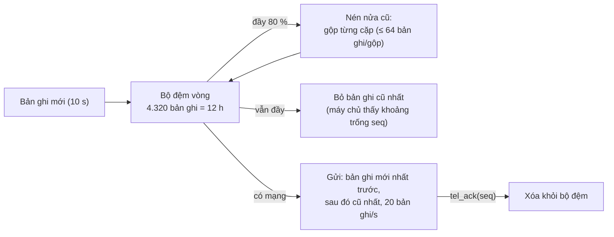
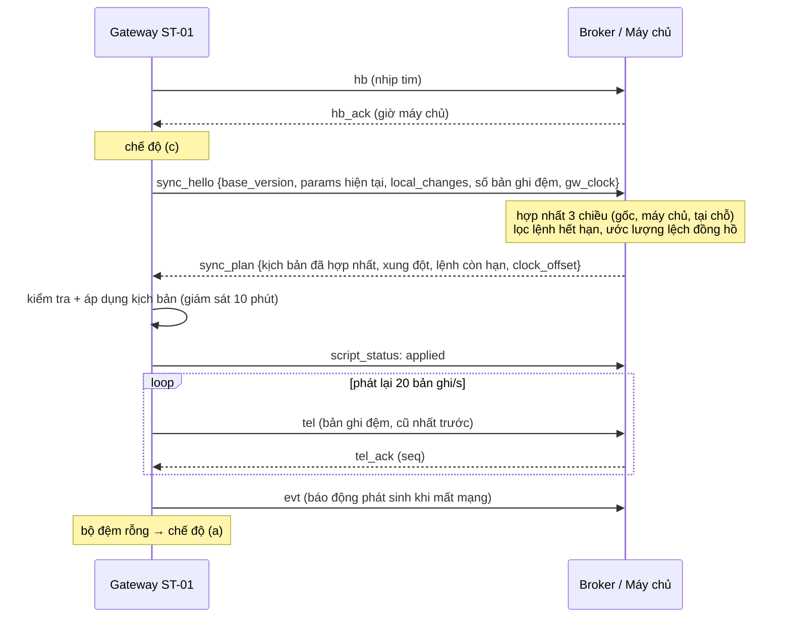

# Giao thức truyền thông, lưu đệm và xử lý xung đột

Thiết kế dùng **MQTT** giữa trạm và máy chủ (bất đối xứng, trạm chủ động kết nối ra ngoài, hợp với 4G có NAT) và
**REST** giữa máy chủ với bảng điều khiển trung tâm, GIS và hệ thống khác. Trong mô phỏng, mỗi loại thông điệp tương ứng
một chủ đề MQTT dưới đây (`trambom/link.py`, `comms.py`, `server.py`).

## 1. Chủ đề MQTT

Tiền tố: `trambom/{site}/{station}/…`, ví dụ `trambom/hn01/ST-01/telemetry`.

| Chủ đề | Hướng | QoS | Retained | Nội dung | Kiểu thông điệp trong mô phỏng |
|---|---|---|---|---|---|
| `state` | trạm → máy chủ | 1 | có | `online` khi kết nối; **LWT** `offline` do broker phát khi trạm mất kết nối bất thường | `hb` |
| `heartbeat` / `heartbeat/ack` | hai chiều | 0 | không | Nhịp tim 10 s; ACK mang giờ máy chủ để ước lượng lệch đồng hồ | `hb`, `hb_ack` |
| `telemetry` | trạm → máy chủ | 1 | không | Bản ghi 10 s hoặc bản ghi gộp sau khi nén, có `seq` | `tel`, `tel_ack` |
| `event` | trạm → máy chủ | 1 | không | Báo động bật/tắt, nhật ký an toàn, xác nhận lệnh; **không bao giờ bị nén hay xóa** | `evt`, `evt_ack` |
| `cmd` | máy chủ → trạm | 1 | không | Lệnh có `id`, `issued_at`, `expires_at` | `cmd` |
| `config/script` | máy chủ → trạm | 1 | **có** | Kịch bản mới nhất (phiên bản, hash) – trạm nhận ngay khi kết nối lại | `script` |
| `config/status` | trạm → máy chủ | 1 | không | `applied` / `committed` / `rejected` / `rollback` | `script_status` |
| `config/local` | trạm → máy chủ | 1 | không | Chỉnh sửa tại HMI khi đang có mạng | `local_change`, `version_assigned` |
| `sync/hello`, `sync/plan` | hai chiều | 1 | không | Bắt tay đồng bộ sau khi mất mạng | `sync_hello`, `sync_plan` |

Phiên MQTT bền (`clean session = false`), TLS 1.2 với chứng chỉ thiết bị riêng cho từng gateway, ACL theo chủ đề (trạm chỉ
được ghi dưới tiền tố của mình). Kịch bản nên được ký số; gateway kiểm tra chữ ký và giới hạn tham số (`script_schema`)
trước khi áp dụng.

### Ví dụ bản ghi đo xa

```json
{
  "seq_lo": 4211, "seq_hi": 4211, "n": 1,
  "t0": 42110, "t1": 42110, "ts0": 42110.00, "ts1": 42110.00,
  "p": 2.43, "p_min": 2.43, "p_max": 2.43, "p_set": 2.45,
  "q": 19.8, "q_min": 19.8, "q_max": 19.8, "q_in": 21.6, "level": 3.41,
  "cl": 0.55, "ntu": 0.17, "ph": 7.2, "kw": 1.96, "kwh": 22.7,
  "f1": 41.8, "f2": 0.0, "mode": "a"
}
```

Sau khi nén, một bản ghi đại diện cho nhiều bản ghi gốc: `seq_lo..seq_hi`, `n` = số bản ghi, các giá trị là trung bình có
trọng số, kèm `p_min/p_max`, `q_min/q_max`.

### Ví dụ lệnh từ trung tâm

```json
{ "id": "C0007", "type": "set_override", "args": { "p_set_bar": 2.8, "ttl_s": 900 },
  "issued_at": 23400, "expires_at": 25200, "by": "Điều độ viên" }
```

Các lệnh hỗ trợ: `set_override`, `clear_override`, `rotate_pumps`, `reset_safe_stop`, `ack_alarm`, `flush_tank`, `select_pt`.

## 2. Phát hiện mất mạng

- Gateway gửi nhịp tim mỗi 10 s. Nếu **60 s** không nhận được ACK, gateway chuyển chế độ (b). Thời gian thực tế từ lúc đứt
  mạng đến lúc chuyển là 50–70 s vì tính từ ACK cuối cùng.
- Máy chủ tự đánh dấu trạm mất kết nối khi 60 s không nhận gì (tương đương LWT). Hai phía quyết định độc lập: không cần
  “thông báo mất mạng”.
- Vì sao không chuyển ngay? Mất một gói không có nghĩa là mất mạng; chuyển chế độ quá nhạy gây dao động (b)↔(a). Học
  viên có thể thử đổi `gateway.offline_after_s`.

## 3. Bộ đệm lưu-và-chuyển



- **Mọi** bản ghi đi qua bộ đệm; chỉ xóa khi máy chủ xác nhận (QoS 1 ở mức ứng dụng). Khi đứt mạng đột ngột, bản ghi đang
  “trên đường” không mất vì chưa được ACK.
- Sự kiện (báo động, nhật ký an toàn, xác nhận lệnh) nằm ở hàng đợi riêng 2.000 mục, không bao giờ bị nén; khi đầy chỉ bỏ
  sự kiện mức `info` cũ nhất.
- Ưu tiên dữ liệu trực tiếp khi phát lại để trung tâm thấy ngay trạng thái hiện tại.
- Với dung lượng 4.320 bản ghi và mức nén tối đa 64 bản ghi gốc/bản ghi gộp, bộ đệm giữ được khoảng 12 h ở độ phân giải đầy đủ,
  và vài ngày ở độ phân giải thô (kịch bản S9: mất mạng 20 h, nén 5 lần, không mất bản ghi nào).

## 4. Bắt tay đồng bộ khi khôi phục kết nối



## 5. Xử lý xung đột khi đồng bộ

| Đối tượng | Nguồn sự thật | Quy tắc |
|---|---|---|
| Dữ liệu đo xa | Gateway | Chỉ ghi thêm; máy chủ chống trùng theo `seq` (phát lại nhiều lần vẫn an toàn); bản ghi đến muộn được đánh dấu `late` |
| Tham số kịch bản – chỉ một phía đổi | Phía thay đổi | Lấy giá trị đó |
| Tham số kịch bản – cả hai phía đổi, **dịch vụ/an toàn** (`merge_policy.service_max`: áp mục tiêu, P_set nhỏ nhất, mức dừng bơm…) | – | Chọn giá trị **bảo thủ** (lớn hơn); ghi lại xung đột |
| Bật/tắt ngủ đông (`service_min`) | – | Chọn giá trị nhỏ hơn (tắt) để bảo vệ thiết bị |
| Tham số vận hành khác | Máy chủ | Máy chủ thắng; xung đột chuyển điều độ viên rà soát |
| Lệnh xếp hàng | Máy chủ | Hết hạn trước khi gửi → hủy; gateway kiểm tra lại hạn khi nhận; `id` chống thực thi hai lần |
| Lệnh ghi đè áp lực | Gateway | Có “hợp đồng thuê” (lease) tối đa 15 phút; hết hạn thì về kịch bản đã lưu, kể cả khi mất mạng |
| Báo động | Gateway | Hợp nhất lịch sử; báo động đã tắt tại trạm thì tắt ở trung tâm |
| Bộ đếm (kWh, giờ chạy, số lần khởi động) | Gateway | Đơn điệu tăng, không xung đột |
| Đồng hồ | Máy chủ (NTP) | Gateway trôi ~40 ppm khi mất mạng; khi đồng bộ, máy chủ tính `clock_offset` và hiệu chỉnh nhãn thời gian |

**Vì sao không dùng “bản ghi mới nhất thắng” (last-writer-wins) cho tham số an toàn?** Đồng hồ hai phía có thể lệch, và
“mới hơn” không có nghĩa là “an toàn hơn”. Ví dụ S3: kỹ thuật viên tăng áp mục tiêu lên 1,7 bar vì dân phản ánh yếu nước,
trong khi trung tâm hạ xuống 1,55 bar để tiết kiệm điện. Quy tắc bảo thủ giữ 1,7 bar và báo cho điều độ viên; nếu dùng LWW,
kết quả phụ thuộc vào ai bấm sau và đồng hồ của ai chạy nhanh.

## 6. Kịch bản mới: kiểm tra, áp dụng có giám sát, quay lui

1. Kiểm tra giới hạn từng tham số theo `script_schema` và ràng buộc chéo (P_set min < max, mức chạy lại > mức dừng…).
   Sai → từ chối, giữ phiên bản cũ, báo `rejected`.
2. Áp dụng ngay nhưng giữ bản cũ; theo dõi 10 phút: nếu áp lệch điểm đặt > 0,3 bar quá 20 % thời gian hoặc có lần cắt áp cao
   → quay lui, báo `rollback`, máy chủ đánh dấu phiên bản lỗi (S3b).
3. Hết 10 phút tốt → `committed`.

Giới hạn: tiêu chí này chỉ thấy lỗi biểu hiện trong 10 phút. Một kịch bản làm sai áp ở điểm bất lợi (gateway không đo được)
hoặc chỉ lỗi ở giờ cao điểm sẽ lọt qua nếu phát hành lúc nhu cầu ổn định – xem phần thảo luận độ tin cậy.

## 7. REST API của máy chủ điều hành (cho bảng điều khiển và tích hợp)

| Phương thức | Đường dẫn | Mô tả |
|---|---|---|
| GET | `/api/v1/stations` | Danh sách trạm, trạng thái kết nối, chế độ, phiên bản kịch bản |
| GET | `/api/v1/stations/{id}/latest` | Bản ghi mới nhất |
| GET | `/api/v1/stations/{id}/timeseries?from=&to=&step=60` | Chuỗi thời gian (đánh dấu khoảng trống, bản ghi gộp, đến muộn) |
| GET | `/api/v1/network/summary?from=&to=` | Tổng lưu lượng, tổng kWh, kWh/m³, tỷ lệ rò rỉ theo trạm và toàn mạng |
| GET | `/api/v1/alarms?active=true` | Cảnh báo tập trung |
| POST | `/api/v1/alarms/{station}/{code}/ack` | Xác nhận báo động (sinh lệnh `ack_alarm`) |
| POST | `/api/v1/stations/{id}/commands` | Gửi lệnh: `{type, args, ttl_s}` → `{id, expires_at}` |
| GET | `/api/v1/stations/{id}/commands/{cmd_id}` | Trạng thái lệnh: queued, ok, rejected, expired_server, duplicate |
| GET/POST | `/api/v1/stations/{id}/scripts` | Danh sách phiên bản / phát hành phiên bản mới (patch + lý do) |
| GET | `/api/v1/stations/{id}/sync-log` | Lịch sử đồng bộ và xung đột đã giải quyết |

Bảng điều khiển trung tâm nên dùng WebSocket hoặc Server-Sent Events để nhận cập nhật trực tiếp thay vì hỏi vòng.

## 8. Dung lượng truyền thông

Mỗi trạm sinh ~8.640 bản ghi/ngày (≈240 byte) cộng nhịp tim và ACK: khoảng 2,6 MB lên và 0,8 MB xuống mỗi ngày
(số liệu `bytes_up/bytes_down` trong báo cáo), tức khoảng 80 MB/tháng – phù hợp gói 4G IoT thông thường. Muốn giảm,
có thể gửi theo ngưỡng thay đổi (report-by-exception) hoặc dùng mã hóa nhị phân (CBOR, Protobuf, Sparkplug B).
