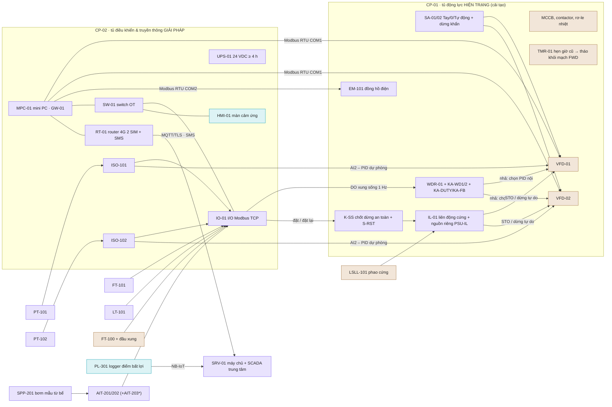

# Hiện trạng nhà máy, giải pháp đưa vào và khuyến nghị bổ sung

Tài liệu này tách bạch ba nhóm thiết bị của trạm bơm tăng áp ST-01:

| Nhóm | Ý nghĩa | Ví dụ | Màu trong mô phỏng |
|---|---|---|---|
| **Hiện trạng** | Thiết bị nhà máy **đã có** trước khi cải tạo. Giữ nguyên, cấu hình lại, nâng cấp nhỏ, hoặc bị giải pháp thay thế. | Bể chứa, van phao, 2 bơm, 2 biến tần, van một chiều, phao chống cạn, tủ động lực CP-01, bộ hẹn giờ lịch cố định TMR-01 | nâu đồng |
| **Giải pháp** | Thiết bị **đưa vào** để tiếp nhận, xử lý và điều khiển tín hiệu tại chỗ. Đây là tập tối thiểu để có đủ 4 chế độ (a)–(d), lớp an toàn ưu tiên cao nhất, khả năng tự vận hành khi mất mạng và dự phòng khi chính mini PC hỏng. | Mini PC công nghiệp MPC-01 chạy edge gateway GW-01, I/O từ xa IO-01, cảm biến áp/lưu lượng/mức/clo/độ đục, bơm mẫu, router 4G, UPS, rơ-le watchdog, chốt dừng an toàn, mạch liên động có nguồn riêng, tủ CP-02 | tím |
| **Khuyến nghị** | **Nên có** để hệ thống vận hành trơn tru nhất. Thiếu vẫn chạy được, nhưng rủi ro hoặc thiệt hại lớn hơn. | Van điện đầu ra MV-02, máy đo pH, màn HMI tại chỗ, logger áp điểm bất lợi, công tắc áp cao cơ khí, phao báo ngập, khóa LOTO… | xanh ngọc |

Trong bản mô phỏng 3D, nút **Hiển thị** trên thanh chức năng có bộ lọc **Hiện trạng / Giải pháp / Khuyến nghị**: tô màu đúng nhóm và làm mờ các nhóm còn lại. Mục **Thiết bị** liệt kê đủ 64 hạng mục. Mỗi hạng mục có vai trò, cách đấu nối với mini PC, hậu quả nếu không có và dự phòng khi hỏng. Danh mục gốc ở `config/components.json`. Phần [2](02-thanh-phan-va-tham-so.md) và bảng ở mục 8 được sinh tự động từ tệp này.

## 1. Tiêu chí phân loại

Một thiết bị được xếp vào **giải pháp** khi không có nó thì **không đạt được ít nhất một yêu cầu** của đề bài:

- điều khiển áp theo lưu lượng;
- luân phiên bơm;
- dừng khi mức bể thấp;
- tự vận hành khi mất mạng;
- đồng bộ khi có mạng lại;
- dừng an toàn khi vượt ngưỡng chất lượng hoặc áp lực;
- không làm trạm kém tin cậy hơn hiện trạng khi chính thiết bị mới hỏng (mini PC, nguồn của tủ mới).

Một thiết bị được xếp vào **khuyến nghị** khi nó làm hệ thống **tin cậy hơn, an toàn hơn hoặc dễ vận hành hơn**, nhưng các yêu cầu trên vẫn đạt khi thiếu nó.

Mỗi hạng mục khuyến nghị phải có lý do cụ thể: kết quả mô phỏng "nếu không lắp" (mục 9), hoặc rủi ro nêu ở mục "Nếu không có" của từng thiết bị (tài liệu [02](02-thanh-phan-va-tham-so.md), mục Thiết bị). Cảm tính không đủ.

Ba góc nhìn chuyên môn được dùng để lập danh mục: tự động hóa OT, cấp nước, IoT/hệ thống nhúng. Một vòng phản biện đối chiếu danh mục với mã nguồn mô phỏng. Ba góc nhìn không hoàn toàn thống nhất ở ranh giới hai nhóm sau:

| Thiết bị | Ý kiến khác | Dự án xếp | Lý do (số liệu ở mục 9) |
|---|---|---|---|
| PT-102 | khuyến nghị | **giải pháp** | Lớp an toàn áp lực cần cảm biến độc lập với vòng điều khiển; PT-102 cũng là cảm biến riêng cho PID dự phòng của VFD-02. Không có PT-102 thì ở mức cơ bản, PT-101 kẹt không bị phát hiện: áp > 4,0 bar suốt 119 phút trong S5. |
| AIT-201, AIT-202 | khuyến nghị | **giải pháp** | Đề bài yêu cầu dừng an toàn theo chất lượng; không đo online thì không thể dừng. S4: không có AIT-202 thì 28,3 m³ nước > 2 NTU ra mạng (có máy: 0,4 m³). S9: không có AIT-201 thì 26,4 m³ nước clo thấp ra mạng (có máy: 1,4 m³). |
| AIT-203 (pH) | giải pháp | **khuyến nghị** | Nước thành phố đã xử lý, pH ít biến động. Nhưng phải nói rõ: **không có AIT-203 thì không có dừng an toàn theo pH**. S13 (pH nguồn 9,5 trong 8 h): 59,4 m³ nước pH > 8,5 ra mạng, có máy chỉ 1,2 m³. Chủ đầu tư chấp nhận rủi ro bằng văn bản. Hạng mục chuyển thành bắt buộc nếu cảm biến clo đã chọn cần bù pH, hoặc nhà máy nguồn có chỉnh pH. |
| WDR-01, ISO-101/102, K-SS, IL-01 | khuyến nghị | **giải pháp** | Mini PC là điểm hỏng đơn lẻ. S11, mini PC treo 6 giờ: • có dự phòng: áp ngoài dải 1 phút; • không có: sau 10 s I/O đưa lệnh chạy về 0, bơm dừng, **362 phút**; • I/O cấu hình "giữ lệnh cuối": vẫn 213 phút. IL-01 có nguồn riêng để hỏng nguồn của tủ mới không làm mất cả chế độ TAY. |
| EM-101 | khuyến nghị | **giải pháp** | Phải so sánh kWh với lịch cố định. Cần đường cơ sở điện năng đo **trước** khi cải tạo. |
| MV-02 | — | **khuyến nghị** | S4 có/không MV-02: lượng nước không đạt ra mạng như nhau (0,4 m³), vì dừng an toàn đã dừng bơm. MV-02 thêm cách ly hẳn và trình tự "mở van trước, chạy bơm sau". |
| FT-100 (đầu xung) | bắt buộc | **hiện trạng + nâng cấp, nên có** | Không có FT-100 thì gateway vẫn phát hiện mất nguồn bằng cân bằng khối lượng, nhưng chậm hơn: 26,0 phút thay vì 13,9 phút (S6). Đầu phát xung rẻ, nên làm cùng đợt. |
| HMI-01 | — | **khuyến nghị** | Web HMI chạy sẵn trên mini PC; kỹ thuật viên có thể dùng laptop hoặc máy tính bảng. Màn cố định trên cửa tủ giúp thao tác nhanh và an toàn hơn. |
| KIT-01, SRV-01 | — | **giải pháp nếu chưa có** | Nhiều xí nghiệp đã có bộ đo cầm tay và SCADA. Khi đó xếp hiện trạng (giữ nguyên, tích hợp MQTT) – đưa vào phiếu khảo sát để tránh mua trùng. |

## 2. Bố trí vật lý: tủ hiện trạng CP-01 và tủ mới CP-02

\* thiết bị khuyến nghị.

Nguyên tắc bố trí:

1. **Thiết bị điện tử và truyền thông mới đặt ở tủ riêng CP-02**, tách khỏi nhiễu và nhiệt của biến tần. Tủ treo tường cạnh CP-01, IP54, có quạt lọc và sưởi chống ngưng tụ.
2. **Những gì phải nằm sát biến tần đặt trong CP-01**: công tắc Tay/0/Tự động, rơ-le watchdog và rơ-le nhân tiếp điểm, chốt dừng an toàn, mạch liên động, rơ-le trung gian, đồng hồ điện. Hai tủ nối với nhau qua hàng kẹp X-IF. Các thiết bị này tuy lắp trong tủ hiện trạng nhưng là **thiết bị của giải pháp**, mỗi thứ một dòng riêng trong danh mục.
3. **Mạch an toàn cứng không đi qua mini PC và không lấy nguồn của tủ mới.** Phao LSLL-101, dừng khẩn, K-SS, công tắc áp cao PSHH-101 (nếu có) và "van MV-02 đóng hẳn" nằm trong chuỗi IL-01, đấu kiểu thường đóng (đứt dây thì dừng). Chuỗi này dùng bộ nguồn 24 VDC riêng PSU-IL trong CP-01.
4. **Không để hai nguồn lệnh chạy song song.** Bộ hẹn giờ lịch cố định hiện có (TMR-01) được tháo khỏi mạch FWD, hoặc giữ làm chế độ "LỊCH" riêng dưới công tắc SA.

Trong cảnh 3D, CP-01 đứng sát tường sau (bên trong là MCCB, VFD-01/02, WDR-01, EM-101 và công tắc SA trên cửa). CP-02 treo ở tường bên (bên trong là MPC-01, IO-01, RT-01, UPS-01; màn HMI-01 trên cửa). Nút **Camera → Tủ điều khiển** đưa camera tới vị trí này.

## 3. Thiết bị hiện trạng: giữ gì, cấu hình lại gì, thay gì

| Thiết bị | Việc cần làm | Vì sao |
|---|---|---|
| VFD-01/02 | Sao lưu tham số gốc. Khóa f_max 50 Hz, đặt f_min 25 Hz, tăng/giảm tần 20 s.  Bật Modbus RTU: địa chỉ 1/2, 19 200 bps, timeout 3–5 s (mất liên lạc thì giữ tần số cuối). Tần số đặt ghi vào **thanh ghi lệnh (RAM)**, không ghi vào tham số lưu EEPROM.  Bật PID nội: điểm đặt 30 % thang 0–10 bar (3,0 bar); Kp ≈ 1,2 (quy đổi từ 6 Hz/bar của mô phỏng), Ti 15 s; nguồn tần số chọn bằng tiếp điểm KA-WD. VFD-01 lấy áp từ PT-101, VFD-02 từ PT-102. Mất phản hồi thì chạy 40 Hz.  Bảo vệ: bật non tải (chạy khô). Tự reset chỉ cho lỗi điện áp, không tự reset lỗi chạm đất hay quá dòng. Tự khởi động lại sau mất điện lệch nhau (≈10 s / ≈40 s). | Hiện trạng biến tần chỉ dùng như khởi động mềm (chạy 50 Hz). Giải pháp khai thác điều khiển tốc độ và dùng PID nội làm lớp dự phòng khi mini PC hỏng. Biến tần không có RS-485 thì lắp card COM-VFD hoặc dùng phương án đầu cực (AO 4–20 mA). |
| TMR-01 | Tháo bộ hẹn giờ / PLC mini đang chạy lịch cố định khỏi mạch FWD, hoặc chuyển thành chế độ "LỊCH" dưới SA. | Các mốc 05:00–22:00, 06–08 h, 17:30–20:30 không có người ở trạm, nên chắc chắn đang có thiết bị tự bật/tắt bơm. Mini PC thay thế chức năng này. |
| HV-01..04 | Mở hết van đẩy đang tiết lưu và niêm phong. Ghi lại vị trí cũ. | Tiết lưu bằng van làm mất năng lượng; biến tần thay vai trò này (xem so sánh với phương án lịch cố định). |
| LSLL-101 | Đấu lại kiểu thường đóng, thêm rơ-le KA-LS lấy tiếp điểm giám sát, thử ngưỡng 0,35 / 0,6 m. Dùng phao từ trên thanh dẫn hướng inox trong ống lặng, hoặc phao cáp treo tự do trong lồng bảo vệ. Không đặt phao cáp trong ống lặng vì phao cáp cần khoảng trống để lật. | Lớp bảo vệ cứng chống chạy khô phải an toàn khi hỏng (fail-safe). |
| FT-100 | Gắn đầu phát xung 10 L/xung vào đồng hồ Woltmann thương mại hiện có. Phối hợp công ty cấp nước để niêm chì lại. GW-01 tự lưu offset bộ đếm. | Đo nước mua vào, phát hiện mất nguồn sớm hơn 12 phút so với cân bằng khối lượng (mục 9), đối soát với công ty cấp nước. |
| CP-01 | Thi công: bố trí chỗ lắp, đi lại dây FWD qua SA → IL-01 → KA-WD, thêm hàng kẹp X-IF, lấy nguồn 230 VAC cho CP-02 qua MCB/RCBO riêng sau SPD-01. | Tủ hiện trạng tiếp tục cấp điện và bảo vệ động lực; phần điều khiển mới nằm ở CP-02 và các thiết bị giải pháp lắp trong CP-01. |
| HT-01, PSV-01 | Giữ nguyên. Kiểm tra áp nạp trước của bình (1,7 bar) mỗi 6 tháng, thử van an toàn hằng năm. Nếu trạm chưa có PSV-01 thì **phải** bổ sung trước khi giao quyền tự động. | Van an toàn là lớp bảo vệ cơ khí cuối cùng; bình tích áp cho phép bơm ngủ đông khi lưu lượng rất nhỏ. |

## 4. Mini PC MPC-01: tiếp nhận – xử lý – điều khiển tín hiệu tại chỗ

**Vai trò.** MPC-01 là phần cứng chạy edge gateway GW-01, tức chính lõi `trambom/gateway.py`, `control.py`, `safety.py`, `comms.py` đã kiểm chứng trong mô phỏng (bản JavaScript chạy trong trình duyệt là bản tương đương). Mọi quyết định được ra **tại chỗ**, chu kỳ 1 s:

- xử lý tín hiệu;
- lớp an toàn;
- kịch bản ngưỡng hoặc dự báo;
- quản lý bơm;
- bộ đệm lưu-và-chuyển.

Máy chủ trung tâm chỉ giúp trạm chạy tốt hơn (phát hành kịch bản, lệnh từ xa, tổng hợp). Máy chủ không phải điều kiện để trạm an toàn. Mini PC cũng **không phải lớp bảo vệ cuối cùng**: mạch cứng và PID nội biến tần vẫn hoạt động khi nó hỏng.

**Cấu hình đề xuất**

- **Phần cứng:** máy tính công nghiệp không quạt, gắn DIN; x86 hoặc ARM công nghiệp 4 nhân; RAM 4–8 GB.
- **Lưu trữ:** SSD hoặc eMMC công nghiệp pSLC 64–128 GB, có bảo vệ mất nguồn.
- **Cổng giao tiếp:** 2 LAN (WAN và mạng OT tách nhau); 2 RS-485 cách ly.
- **Bảo mật:** watchdog phần cứng, TPM 2.0, Secure Boot, RTC có pin.
- **Nguồn và môi trường:** nguồn 9–36 VDC từ UPS-01; −20…60 °C (nên chọn −40…70 °C vì trong tủ nóng hơn môi trường 10–15 °C); công suất 10–15 W.
- **Lưu ý:** không dùng PC văn phòng hay thẻ SD.

**Phần mềm** (Linux LTS, phân vùng gốc chỉ đọc, cập nhật kiểu A/B có tự quay lui):

| Dịch vụ | Việc | Chu kỳ |
|---|---|---|
| `io` | Modbus TCP tới IO-01: AI 4–20 mA (NAMUR NE43: bão hòa 3,8/20,5 mA vẫn hợp lệ, < 3,6 mA là mất tín hiệu), DI, đếm xung FT-100, DO, xung sống watchdog | 100–200 ms |
| `drive` | Modbus RTU COM1 – **chỉ** VFD-01/02 (tách bus để thiết bị đo chậm không làm trễ lệnh bơm) | 0,5–1 s |
| `meter` | Modbus RTU COM2: EM-101, bộ phân tích AIT, FT-101 (tổng m³), nhiệt ẩm tủ | 2–10 s |
| `control` | Lõi GW-01: lọc, đối chiếu PT-101/102 + mô hình bơm, lớp an toàn, kịch bản, quản lý bơm, chế độ TAY | 1 s |
| `comms` | MQTT/TLS 8883 (QoS 1, phiên bền, LWT), bộ đệm SQLite trên SSD, đồng bộ khi có mạng lại | 10 s |
| `hmi` | Web HMI cục bộ (màn hình HMI của mô phỏng), phân quyền, nhật ký thao tác | – |
| `sms` | Gửi SMS báo động khẩn qua API của RT-01 khi mất IP | theo sự kiện |

**Thứ tự thời gian khi mini PC treo** (mô phỏng bằng `config/station.json` → `fallback`):

1. Mini PC ngừng đảo DO xung sống.
2. Sau **5 s** (`watchdog_s`) WDR-01 nhả. Biến tần bơm chính, tức bơm đang chạy mà mini PC đã chốt lên KA-DUTY, chuyển sang PID nội.
3. Sau **10 s** (`io_timeout_s` ≥ 2 × `watchdog_s`) mô-đun I/O mới hết thời gian chờ truyền thông và đưa DO về 0. Lúc này lệnh chạy đã đi qua mạch dự phòng nên bơm không dừng.

Nếu đặt ngược thứ tự (I/O 3 s, watchdog 5 s), bơm sẽ bị lệnh dừng trước khi PID nhận quyền: sụt áp và thêm một lần khởi động.

Khi mini PC khởi động lại:

1. Nạp kịch bản, mô hình dự báo và bộ đệm từ SSD.
2. **Hủy phiên điều khiển tay cũ**: không để lệnh tay của một người không còn ở đó "sống lại".
3. **Theo dõi 60 s** (`takeover_s`) trong khi PID nội vẫn điều khiển.
4. Tiếp quản không xung (khởi tạo bộ PI từ tần số đang chạy), rồi đồng bộ với trung tâm (chế độ c).

**Vì sao mini PC, không phải PLC?** Các chức năng dự báo 168 giờ, bộ đệm hàng nghìn bản ghi, hợp nhất ba chiều, MQTT/TLS và web HMI chạy tự nhiên trên Linux; PLC nhỏ làm được nhưng khó. Đổi lại, mini PC kém tin cậy hơn PLC. Vì vậy giải pháp bù bằng ba lớp:

1. watchdog ba tầng (dịch vụ, phần cứng, rơ-le ngoài WDR-01);
2. PID nội biến tần làm dự phòng;
3. mạch liên động cứng có nguồn riêng.

Một phương án thay thế hợp lệ là **PLC nhỏ** giữ vòng điều khiển và an toàn, còn **mini PC** chỉ làm gateway (dự báo, truyền thông, HMI). Phương án này đắt hơn, tin cậy hơn và phù hợp trạm lớn. Bài tập so sánh hai kiến trúc ở mục 11.

## 5. Danh sách tín hiệu (I/O list)

| Tag | Tín hiệu | Loại | Kênh / bus | Ghi chú |
|---|---|---|---|---|
| PT-101 | Áp đầu ra – điều khiển | AI 4–20 mA | IO-01 AI1 qua ISO-101 (ra thêm AI2 của VFD-01) | NE43: < 3,6 mA là mất tín hiệu; bão hòa vẫn hợp lệ, báo SENSOR_RANGE |
| PT-102 | Áp đầu ra – bảo vệ | AI 4–20 mA | IO-01 AI2 qua ISO-102 (ra thêm AI2 của VFD-02) | Điểm trích riêng; lớp an toàn dùng max(PT-101, PT-102) |
| FT-101 | Lưu lượng ra mạng | AI 4–20 mA + Modbus | IO-01 AI3; tổng m³ qua COM2 | Cắt lưu lượng nhỏ 0,3 m³/h |
| LT-101 | Mức bể | AI 4–20 mA | IO-01 AI4 | Có chống sét tín hiệu (cáp từ nắp bể) |
| AIT-201 | Clo dư | AI 4–20 mA / Modbus | IO-01 AI5 | Thang 0–5 mg/L; chỉ hợp lệ khi FS-201 báo có dòng mẫu |
| AIT-202 | Độ đục | AI 4–20 mA | IO-01 AI6 | Thang rộng 0–100 NTU |
| AIT-203 | pH (khuyến nghị) | AI 4–20 mA | IO-01 AI7 | Bù pH cho đo clo |
| PT-100 | Áp ống cấp (tùy chọn) | AI 4–20 mA | IO-01 AI8 | |
| LT-102 | Mức dự phòng (tùy chọn) | AI 4–20 mA | IO-01 AI9 | IO-01 ≥ 12 AI để vẫn dư ≥ 20 % |
| FT-100 | Lưu lượng vào | Xung 10 L/xung | IO-01 DI bộ đếm | Lưu lượng trượt ≈ 60 s; GW-01 tự lưu offset bộ đếm |
| LSLL-101 | Phao chống cạn | DI (NC) | IO-01 DI1 qua KA-LS | Chỉ giám sát – mạch cắt bơm là IL-01 |
| VFD-01/02 | Chạy / lỗi | DI | IO-01 DI2–DI5 | Đối chiếu với trạng thái đọc qua Modbus |
| SA-01/02 | Vị trí Tay / Tự động | DI | IO-01 DI6–DI9 | SA khác TỰ ĐỘNG → bơm không sẵn sàng với GW-01 |
| MV-02 | Vị trí mở / đóng | DI | IO-01 DI10–DI11 | Đóng hẳn → liên động cấm chạy bơm |
| UPS-01 | Mất điện lưới / ắc quy yếu | DI | IO-01 DI12–DI13 | Tiếp điểm riêng cho IO-01 và RT-01 |
| FS-201, ZS-01, LSH-01 | Dòng mẫu, cửa, ngập | DI | IO-01 DI14–DI16 | |
| SPP-201 | Bơm mẫu chạy / lỗi | DI | IO-01 DI17 | |
| ZSC-VX01 | Van xả đáy đóng hẳn | DI | IO-01 DI18 | Cho cân bằng khối lượng |
| WDR-01, KA-DUTY | Trạng thái watchdog, bơm chính đã chốt | DI | IO-01 DI19–DI20 | |
| K-SS, S-RST | Chốt dừng an toàn, công tắc đặt lại | DI | IO-01 DI21–DI22 | Ghi nhật ký mọi lần đặt lại bằng tay |
| VFD-01/02 | Lệnh chạy | DO | IO-01 DO1–DO2 → KA-DO → SA → IL-01 → KA-WD → FWD | Mất truyền thông IO 10 s → về 0 (WDR-01 đã chuyển PID sau 5 s) |
| WDR-01 | Xung sống | DO bán dẫn 1 Hz | IO-01 DO3 | Chỉ đảo khi một chu kỳ điều khiển thành công; rơ-le kích theo sườn |
| MV-02 | Mở / đóng | DO | IO-01 DO4–DO5 → contactor đảo chiều KA-DO | |
| VX-01A | Xả đáy (tùy chọn) | DO | IO-01 DO6 | Chỉ được mở khi trạm đang dừng an toàn |
| SPP-201 | Chạy bơm mẫu | DO | IO-01 DO7 | |
| KA-DUTY | Chốt bơm chính | DO | IO-01 DO8 | Đặt mỗi lần luân phiên / khi chạy tay |
| K-SS | Đặt / đặt lại chốt dừng an toàn | DO | IO-01 DO9–DO10 | Đặt khi SAFE_STOP hoặc LOCKOUT |
| VFD-01/02 | Tần số đặt, f, I, kW, kWh, mã lỗi | Modbus RTU | COM1, địa chỉ 1 / 2 | |
| EM-101 | kW, kWh, cos φ | Modbus RTU | COM2, địa chỉ 10 | |

## 6. Phân cấp dự phòng – điều gì còn lại khi từng thứ hỏng

| Lớp | Cơ chế | Còn hoạt động khi … |
|---|---|---|
| 0 – Cơ khí | Van phao FV-01, van một chiều, f_max khóa 50 Hz, van an toàn PSV-01 6 bar, bồn mái hộ dân (đệm ≈1,5 h) | mất điện, mất mọi điện tử |
| 1 – Liên động cứng | Chuỗi IL-01 (nguồn riêng PSU-IL): LSLL-101 (0,35 m), dừng khẩn, PSHH-101* (4,3–4,4 bar), MV-02 không mở hết → cấm chạy; rơ-le chốt K-SS (đặt lại bằng lệnh hoặc công tắc khóa S-RST) | mini PC, IO-01, nguồn CP-02 hỏng |
| 2 – Bảo vệ nội biến tần | Quá dòng, quá nhiệt, mất pha, non tải, tự khởi động lại có trễ | mọi chế độ |
| 3 – GW-01 | Lớp an toàn phần mềm (cắt > 4,5 bar theo max(PT-101, PT-102), chống chạy khô 0,5 m, dừng an toàn chất lượng QCVN, tối đa 6 lần khởi động/giờ) + kịch bản ngưỡng / dự báo | mini PC còn chạy – **mọi chế độ (a)–(d), kể cả khi mất mạng** |
| 4 – Lỗi cảm biến (đã có trong mô phỏng) | Biểu quyết PT-101/PT-102/mô hình bơm (mức nâng cao); kẹt cứng 30 s → loại cảm biến; mất cả hai áp → 40 Hz; FT-100 không lắp hoặc mất tín hiệu → cân bằng khối lượng; FT-101 lỗi → không ước lượng lưu lượng vào (không báo mất nguồn giả); máy phân tích mất tín hiệu → cảnh báo, không dừng giả; bão hòa ngoài thang → vẫn dùng cho dừng an toàn | mini PC còn chạy |
| 4b – Đề xuất mở rộng (chưa có trong mô phỏng) | LT-101 lỗi → chuyển LT-102 hoặc cân bằng nước (hiện chỉ giữ giá trị cuối, phao cứng vẫn bảo vệ); FT-101 lỗi → ước lượng Q từ mô hình bơm, nâng P_set bảo thủ | |
| 5 – Mất mạng | Chế độ (b): kịch bản đã lưu + biên áp; lệnh ghi đè hết hạn; bộ đệm trên SSD; SIM thứ hai; SMS (kể cả báo động khẩn phát sinh trong ≤ 60 s trước khi phát hiện mất mạng); **quyền TAY từ xa tự hủy** | mất 4G |
| 6 – Mất Modbus tới biến tần | Biến tần giữ tần số cuối; > 10 s → mini PC chủ động ngừng xung sống để chuyển PID nội | mini PC còn chạy |
| 7 – Mini PC treo | Sau 5 s WDR-01 nhả. Biến tần của bơm đang chạy (KA-DUTY) chạy PID nội 3,0 bar theo cảm biến riêng của nó (VFD-01 ← PT-101, VFD-02 ← PT-102). Biến tần đó lỗi thì KA-FB chuyển sang bơm kia; bơm thứ hai dừng. MV-02 giữ vị trí: đang đóng thì liên động cấm chạy. Đang dừng an toàn hoặc khóa thì giữ dừng (K-SS). Trung tâm phát hiện qua LWT sau ≈1 phút. Lệnh trên HMI-01 không tới được bộ điều khiển. | **S11** |
| 8 – Mất phản hồi áp khi PID nội | Biến tần chạy tần số đặt sẵn 40 Hz (chốt khi chạy thử sao cho áp đêm ≤ 4,0 bar) | |
| 9 – Mất điện lưới | Bơm dừng; UPS-01 giữ mini PC, IO-01, router, cảm biến ≥ 4 h để đo, lưu, cảnh báo; có điện lại thì khởi động lệch nhau | |

\* khuyến nghị.

**Mất gì ở lớp 7?** Khi chỉ còn PID nội biến tần, các chức năng sau không còn:

- dừng an toàn theo chất lượng nước;
- cắt áp rất cao bằng phần mềm (chỉ còn PSHH-101 nếu có và PSV-01 6 bar);
- ghép, tách và luân phiên bơm;
- áp đặt theo lưu lượng (áp cố định 3,0 bar tốn điện và tăng rò rỉ hơn);
- đo xa, SMS;
- màn HMI tại chỗ (HMI chỉ là trang web do mini PC phục vụ).

Vì vậy mini PC treo phải được khắc phục trong vài giờ (vật tư dự phòng DP-01: một mini PC đã nạp sẵn ảnh hệ thống).

## 7. Điều khiển bơm từ xa và tại chỗ (HMI)

Ngoài chế độ tự động theo kịch bản, người vận hành có thể chuyển trạm sang chế độ **TAY bằng phần mềm** để chạy hoặc dừng từng bơm, đặt tần số, đóng hoặc mở van MV-02. Có hai vị trí ra lệnh. Kịch bản S12 trình diễn cả hai.

| | Tại trạm – HMI-01 (hoặc laptop nối mạng OT của CP-02) | Trung tâm – SCADA (SRV-01) |
|---|---|---|
| Dữ liệu nhìn thấy | Trực tiếp từ gateway, thời gian thực; có chi tiết liên động | Chỉ những gì máy chủ nhận qua MQTT (chu kỳ 10 s); mất mạng thì đứng yên và gắn nhãn "dữ liệu cũ" |
| Đường lệnh | Đi thẳng vào GW-01, không hết hạn | Qua máy chủ → MQTT; lệnh tay có hạn **60 s**; mất mạng thì lệnh xếp hàng rồi hết hạn |
| Quyền | **Ưu tiên cao nhất**: thao tác tại chỗ giành quyền; lệnh từ xa bị từ chối khi tại chỗ đang giữ quyền. Quyền tại chỗ **không** tự hủy khi mất 4G (người vận hành đang đứng ở trạm) | Có thời hạn (lease) 30 phút, mỗi lệnh gia hạn. Hết hạn, hoặc **mất kết nối** (trạm chuyển sang chế độ b), thì trạm tự trở về TỰ ĐỘNG |

Luôn đúng ở mọi vị trí:

- **An toàn đứng trên lệnh tay.** Lệnh tay vẫn đi qua lớp an toàn và bộ quản lý bơm: giới hạn áp cao (tần số tay bị hạ khi áp tới 4,0 bar), cắt áp rất cao, chống chạy khô, dừng an toàn chất lượng, tối đa 6 lần khởi động/giờ, nghỉ tối thiểu 60 s.
- **Không có bơm "thay thế" tự chạy.** Bơm được lệnh chạy mà đang bị chặn (đang trong thời gian nghỉ tối thiểu, quá số lần khởi động, biến tần lỗi) thì chờ hoặc đứng yên.
- **Bơm lỗi phải được ra lệnh lại.** Bơm lỗi khi đang chạy tay bị xóa lệnh chạy; sửa xong không tự chạy lại.
- **Liên động van.** Van MV-02 không mở hết thì cấm chạy bơm (điều kiện cho phép). Van mở lại thì bơm chạy tiếp theo lệnh tay.
- **Cắt an toàn thì không tự chạy lại.** Bị cắt khi đang chạy tay (áp rất cao, mức rất thấp, dừng an toàn) thì người vận hành phải ra lệnh mới.
- **Kịch bản mới không bị đánh giá oan.** Trong lúc chạy tay, cửa sổ giám sát 10 phút của kịch bản vừa phát hành tạm dừng: lệnh tay không làm kịch bản bị quay lui oan.
- **Mini PC khởi động lại** thì mọi phiên tay bị hủy. Mini PC treo thì thao tác trên HMI-01 không có tác dụng.
- **Luôn hiển thị trạng thái tay.** Báo động `MANUAL_MODE` hiển thị ở cả hai phía để không ai quên trạm đang chạy tay.

Phân biệt với **công tắc cứng SA-01/02** trên cửa CP-01:

- Vị trí TAY của công tắc chuyển biến tần sang điều khiển bằng bàn phím, hoàn toàn không qua mini PC; chỉ còn liên động cứng bảo vệ. Dùng khi bảo trì hoặc khi mini PC và I/O cùng hỏng.
- Vị trí 0 chỉ là "dừng điều khiển", **không phải** điểm cách ly năng lượng. Khóa – treo thẻ (LOTO) làm trên aptomat QF-01/02 có tay khóa.

Giao thức của các lệnh `set_mode`, `pump_start`, `pump_stop`, `pump_speed`, `valve` ở [03-giao-thuc-truyen-thong.md](03-giao-thuc-truyen-thong.md).

## 8. Danh mục thiết bị (sinh tự động từ `config/components.json`)

<!-- BOM-START -->
### Hiện trạng nhà máy (đã có) – 17 hạng mục

| Mã | Thiết bị | Thay đổi | Ưu tiên | Vai trò | Giao tiếp với mini PC |
|---|---|---|---|---|---|
| `T-01` | Bể chứa nước sạch (bể ngầm/bán ngầm) | giữ nguyên | bắt buộc | Nguồn hút và bộ đệm thể tích/chất lượng của trạm. | Không nối trực tiếp; được đo bằng LT-101 (giải pháp) và phao LSLL-101 (hiện trạng). |
| `FV-01` | Van phao cấp nước vào bể | giữ nguyên | bắt buộc | Tự cấp nước vào bể theo mức, không cần điện. | Không nối mini PC. Trạng thái suy ra từ lưu lượng vào (FT-100 hoặc cân bằng khối lượng). |
| `VX-01` | Van xả đáy bể | giữ nguyên | bắt buộc | Xả cặn/súc rửa bể sau sự cố chất lượng. | Hiện trạng là van tay: kỹ thuật viên mở theo lệnh xả của trung tâm. Công tắc hành trình ZSC-VX01 (giải pháp) báo van đóng hẳn để cân bằng khối lượng không bị sai khi xả tay. Bộ truyền động điện VX-01A (khuyến nghị) cho phép xả từ xa. |
| `P-01` | Bơm ly tâm trục ngang số 1 (5,5 kW) | giữ nguyên | bắt buộc | Bơm chính/dự phòng luân phiên; công suất thủy lực của trạm. | Gián tiếp qua biến tần VFD-01 (hiện trạng, cấu hình lại). |
| `P-02` | Bơm ly tâm trục ngang số 2 (5,5 kW) | giữ nguyên | bắt buộc | Bơm thứ hai: dự phòng nóng và ghép song song khi nhu cầu cao. | Gián tiếp qua biến tần VFD-02. |
| `VFD-01` | Biến tần bơm P-01 (hiện có) | cấu hình lại | bắt buộc | Điều khiển tốc độ bơm P-01 theo lệnh mini PC; PID nội làm dự phòng khi mini PC hỏng. | Modbus RTU (RS-485 COM1 của MPC-01, địa chỉ 1, 19 200 bps 8E1): ghi tần số đặt vào thanh ghi lệnh (RAM, không lưu EEPROM), đọc f, I, kW, kWh, mã lỗi. Lệnh chạy: DO IO-01 → rơ-le trung gian → SA-01 (TỰ ĐỘNG) → chuỗi liên động IL-01 → KA-WD1 (WDR-01) → FWD. AI2 nhận PT-101 qua ISO-101. DI chọn nguồn tần số Modbus/PID do KA-WD1 điều khiển; DI "tại chỗ/bàn phím" do vị trí TAY của SA-01 điều khiển (ưu tiên hơn). |
| `VFD-02` | Biến tần bơm P-02 (hiện có) | cấu hình lại | bắt buộc | Điều khiển tốc độ bơm P-02; nhận PID dự phòng khi P-02 là bơm chính hoặc VFD-01 lỗi. | Modbus RTU COM1 địa chỉ 2; lệnh chạy qua SA-02 → IL-01 → KA-WD2; AI2 nhận PT-102 qua ISO-102 (không có PT-102 thì nhận PT-101). |
| `CV-01/02` | Van một chiều sau bơm | giữ nguyên | bắt buộc | Ngăn dòng ngược qua bơm đang dừng. | Không nối mini PC. |
| `HV-01..04` | Van tay chặn hút và van đẩy từng bơm | giữ nguyên | bắt buộc | Van tay chặn hút/đẩy từng bơm để bảo trì. | Không nối mini PC. |
| `HT-01` | Bình tích áp màng (thủy khí) | giữ nguyên | nên có | Làm mềm dao động áp, cho phép bơm ngủ đông khi lưu lượng rất nhỏ. | Không nối mini PC (áp lực đo bằng PT-101/102). |
| `PSV-01` | Van an toàn cơ khí (xả về bể) | giữ nguyên | bắt buộc | Lớp bảo vệ cơ khí cuối cùng khi áp quá cao. | Không nối mini PC; trạng thái xả thấy được qua lưu lượng. |
| `PI-101/102` | Đồng hồ áp lực cơ trên ống đẩy từng bơm | giữ nguyên | nên có | Chỉ thị tại chỗ để đối chiếu với PT-101/102. | Không nối mini PC. |
| `FT-100` | Đồng hồ nước vào bể (Woltmann hiện có + đầu phát xung) | nâng cấp | nên có | Đo nước mua vào: cân bằng nước, phát hiện mất nguồn sớm, dự báo thời gian cạn bể, đối soát với công ty cấp nước. | Xung → DI đếm xung của IO-01 (≥ 100 Hz), lọc thành lưu lượng trượt ≈ 60 s. |
| `LSLL-101` | Phao chống cạn cơ khí (mạch cứng) | nâng cấp | bắt buộc | Chống chạy khô bằng mạch cứng, độc lập phần mềm. | Chuỗi liên động cứng IL-01 trong CP-01 (tác động ở mọi chế độ Tay/Tự động/PID nội). Tiếp điểm phụ KA-LS → DI IO-01 (chỉ để giám sát). |
| `CP-01` | Tủ động lực MCC hiện có (CP-01) | nâng cấp | bắt buộc | Tủ động lực hiện có: cấp điện và bảo vệ cho 2 bơm/biến tần. | Hàng kẹp X-IF sang CP-02: lệnh chạy, trạng thái, RS-485, 4–20 mA. |
| `TMR-01` | Bộ hẹn giờ lịch cố định hiện có trong CP-01 | thay thế | bắt buộc | Bộ hẹn giờ / PLC mini hiện có đang bật tắt bơm theo lịch cố định (05:00–22:00, 06–08 h, 17:30–20:30). | Tháo khỏi mạch FWD, hoặc giữ làm chế độ "LỊCH" riêng dưới công tắc SA-01/02 – không bao giờ để hai nguồn lệnh chạy song song. |
| `MANG-LUOI` | Mạng lưới phân phối khu dân cư A (DMA-A) | giữ nguyên | bắt buộc | Đối tượng phục vụ; áp tại điểm bất lợi là chỉ tiêu dịch vụ. | Không nối trực tiếp; logger PL-301 (khuyến nghị) gửi áp điểm bất lợi về trung tâm. |

### Giải pháp đưa vào (tiếp nhận – xử lý – điều khiển tín hiệu tại chỗ) – 27 hạng mục

| Mã | Thiết bị | Thay đổi | Ưu tiên | Vai trò | Giao tiếp với mini PC |
|---|---|---|---|---|---|
| `MPC-01` | Mini PC công nghiệp không quạt (phần cứng edge gateway) | bổ sung mới | bắt buộc | Phần cứng edge gateway: tiếp nhận, xử lý, điều khiển tín hiệu tại chỗ; chạy GW-01 và web HMI. | LAN1 ↔ RT-01 (WAN). LAN2 ↔ SW-01 (mạng OT: IO-01, HMI-01). COM1 RS-485 cách ly ↔ VFD-01/02. COM2 RS-485 cách ly ↔ EM-101, AIT, FT-101. Nguồn 24 VDC từ UPS-01. Xung sống tới WDR-01 qua DO bán dẫn của IO-01. |
| `GW-01` | Phần mềm edge gateway GW-01 (chạy trên MPC-01) | bổ sung mới | bắt buộc | Phần mềm edge gateway chạy trên MPC-01 (lõi đã mô phỏng trong dự án này). | Đọc/ghi I/O qua dịch vụ io/drive/meter; MQTT/TLS 8883 tới SRV-01; web HMI cho HMI-01. |
| `IO-01` | Mô-đun I/O từ xa Modbus TCP | bổ sung mới | bắt buộc | Mô-đun vào/ra từ xa: số hóa tín hiệu 4–20 mA, tiếp điểm, xung; xuất lệnh. | Modbus TCP qua SW-01 (chu kỳ 100–200 ms). Cấp nguồn vòng cho cảm biến 2 dây. DO đóng cắt thiết bị hiện trường qua rơ-le trung gian KA-DO. |
| `CP-02` | Tủ điều khiển & truyền thông mới (CP-02) | bổ sung mới | bắt buộc | Tủ mới của giải pháp: tách thiết bị điện tử, truyền thông khỏi tủ động lực. | Cáp tín hiệu, RS-485 và nguồn 230 VAC từ CP-01 qua hàng kẹp X-IF. |
| `SW-01` | Switch Ethernet công nghiệp (mạng OT) | bổ sung mới | bắt buộc | Switch công nghiệp cho mạng OT trong tủ CP-02. | Nối MPC-01 (LAN2), IO-01, HMI-01, cổng bảo trì. |
| `RT-01` | Router 4G/LTE công nghiệp 2 SIM có SMS | bổ sung mới | bắt buộc | Kết nối 4G tới trung tâm; gửi SMS dự phòng khi mất IP. | Ethernet ↔ MPC-01 LAN1; API SMS của router. |
| `UPS-01` | Nguồn 24 VDC + DC-UPS + ắc quy | bổ sung mới | bắt buộc | Giữ mini PC, I/O, router, cảm biến ≥ 4 h khi mất điện lưới. | Hai tiếp điểm riêng (hoặc rơ-le trung gian 2 C/O) báo mất điện lưới / ắc quy yếu → DI IO-01 và RT-01 – không đấu song song một tiếp điểm vào hai thiết bị khác nguồn. |
| `WDR-01` | Rơ-le watchdog + rơ-le nhân tiếp điểm, chốt chọn bơm (lắp trong CP-01) | bổ sung mới | bắt buộc | Cắt quyền điều khiển của mini PC khi nó ngừng phát xung sống, chuyển biến tần sang PID nội. | Đầu vào: DO bán dẫn của IO-01 (xung 1 Hz). Đầu ra: KA-WD1/KA-WD2 → DI chọn nguồn tần số của VFD-01/02 (mỗi biến tần dùng nguồn 24 V nội riêng, không chung tiếp điểm), chuyển lệnh chạy sang KA-FB; tiếp điểm riêng báo về DI IO-01 và RT-01. KA-DUTY: 1 DO đặt + 1 DI đọc lại. |
| `K-SS` | Rơ-le chốt dừng an toàn + công tắc khóa đặt lại S-RST | bổ sung mới | bắt buộc | Rơ-le chốt dừng an toàn: giữ trạm dừng khi mini PC hỏng trong lúc đang dừng an toàn hoặc đang khóa do áp cao. | DO đặt / DO đặt lại từ IO-01; tiếp điểm trạng thái → DI; S-RST → cuộn reset + DI ghi nhật ký. |
| `IL-01` | Mạch liên động cứng + nguồn riêng PSU-IL (lắp trong CP-01) | bổ sung mới | bắt buộc | Chuỗi liên động cứng (rơ-le KA-IL, KA-LS, dừng khẩn ES-01, K-SS, MV-02 đóng → cấm chạy) với nguồn 24 VDC riêng PSU-IL. | Không qua mini PC; tiếp điểm phụ báo trạng thái về DI IO-01. |
| `KA-DO` | Rơ-le trung gian, contactor đảo chiều van | bổ sung mới | bắt buộc | Rơ-le trung gian cho các DO của IO-01 và bộ contactor đảo chiều có khóa chéo cho động cơ van MV-02. | DO IO-01 → KA-DO → thiết bị hiện trường. |
| `COM-VFD` | Card truyền thông cho biến tần (có điều kiện) | bổ sung mới | tùy chọn | Card truyền thông RS-485/Modbus cho biến tần – chỉ khi biến tần hiện có chưa có cổng. | Lắp vào biến tần, nối bus COM1. |
| `ISO-101` | Bộ cách ly và chia tín hiệu 4–20 mA (ISO-101, ISO-102) | bổ sung mới | bắt buộc | Chia tín hiệu áp cho cả IO-01 và PID nội của biến tần; cách ly chống nhiễu. | PT-101 → ISO-101 (1 vào 2 ra) → IO-01 AI1 + VFD-01 AI2. PT-102 → ISO-102 → IO-01 AI2 + VFD-02 AI2. Mỗi biến tần có cảm biến riêng ở chế độ dự phòng. Các kênh khác dùng loại 1 vào 1 ra. |
| `SA-01/02` | Công tắc chọn chế độ, đèn báo, dừng khẩn | bổ sung mới | bắt buộc | Công tắc Tay/0/Tự động từng bơm, đèn báo và nút dừng khẩn trên cửa CP-01. | 2 DI/bơm (Tay, Tự động) → IO-01: SA khác TỰ ĐỘNG thì GW-01 coi bơm là không sẵn sàng. Tiếp điểm TAY → DI "điều khiển tại chỗ/bàn phím" của biến tần (ưu tiên hơn DI chọn nguồn của WDR-01). Đèn Chạy/Lỗi/Tự động/Dự phòng PID. |
| `PT-101` | Cảm biến áp lực đầu ra (điều khiển) | bổ sung mới | bắt buộc | Áp đầu ra cho vòng điều khiển PI và PID dự phòng của biến tần. | AI 4–20 mA 2 dây → ISO-101 → IO-01 AI1 (+ VFD-01/02 AI2). |
| `PT-102` | Cảm biến áp lực đầu ra (bảo vệ, dự phòng) | bổ sung mới | bắt buộc | Áp đầu ra cho lớp an toàn (cắt áp rất cao theo max(PT-101, PT-102)), đối chiếu chéo với PT-101 và tín hiệu PID dự phòng của VFD-02. | AI 4–20 mA → ISO-102 → IO-01 AI2 + VFD-02 AI2; điểm trích áp riêng. |
| `FT-101` | Đồng hồ lưu lượng điện từ đầu ra | bổ sung mới | bắt buộc | Lưu lượng ra mạng: đường đặt áp P_set(Q), dự báo, phát hiện rò rỉ đêm, cân bằng khối lượng. | AI 4–20 mA → IO-01 AI3; tổng m³ qua Modbus RTU COM2. |
| `LT-101` | Cảm biến mức siêu âm | bổ sung mới | bắt buộc | Mức bể: dừng chống chạy khô theo kịch bản, tiết kiệm nước, dự báo thời gian cạn bể, cảnh báo mức cao. | AI 4–20 mA → IO-01 AI4 qua chống sét tín hiệu. |
| `AIT-201` | Máy đo clo dư tự do (amperometric) | bổ sung mới | bắt buộc | Clo dư online: dừng an toàn khi < 0,2 mg/L (QCVN 01-1:2018/BYT). | AI 4–20 mA → IO-01 AI5 (hoặc Modbus RTU COM2); chỉ hợp lệ khi công tắc dòng mẫu FS-201 báo có nước. |
| `AIT-202` | Máy đo độ đục (nephelometric) | bổ sung mới | bắt buộc | Độ đục online: dừng an toàn khi > 2 NTU kéo dài 60 s. | AI 4–20 mA → IO-01 AI6. |
| `SP-201` | Panel lấy mẫu + bơm mẫu SPP-201 + công tắc dòng mẫu FS-201 | bổ sung mới | bắt buộc | Panel lấy mẫu cho máy phân tích, kèm công tắc dòng mẫu FS-201 và bơm mẫu SPP-201 hút thẳng từ bể. | Bơm mẫu: 1 DO + 1 DI chạy/lỗi; FS-201 → DI IO-01. |
| `EM-101` | Đồng hồ điện đa năng 3 pha có Modbus | bổ sung mới | bắt buộc | Đo điện năng toàn trạm: chỉ tiêu kWh/m³ và đường cơ sở trước cải tạo. | Modbus RTU COM2, địa chỉ 10; 3 biến dòng ở đầu tổng. |
| `KIT-01` | Bộ đo chất lượng nước cầm tay | bổ sung mới | bắt buộc | Bộ đo cầm tay clo dư (DPD), độ đục, pH để hiệu chuẩn máy online, nội kiểm và xác nhận trước khi đặt lại. | Không nối mini PC; kết quả nhập vào HMI/nhật ký. |
| `SPD-01` | Chống sét lan truyền (nguồn, tín hiệu, ăng-ten) | bổ sung mới | bắt buộc | Chống sét lan truyền đường nguồn, tín hiệu, RS-485 và ăng-ten; nối đất đẳng thế. | Đầu vào 3 pha CP-01, đường 230 VAC sang CP-02, cáp tín hiệu LT-101/PT ngoài trời, ăng-ten RT-01. |
| `SRV-01` | Máy chủ điều hành & SCADA trung tâm (dùng chung ST-01…ST-04) | bổ sung mới | bắt buộc | Máy chủ điều hành trung tâm + SCADA: nhận dữ liệu, phát hành kịch bản, lệnh từ xa, cảnh báo tập trung. | MQTT broker + REST API; dashboard; giữ kịch bản retained, hàng đợi lệnh có thời hạn. |
| `ZSC-VX01` | Công tắc hành trình van xả đáy | bổ sung mới | nên có | Công tắc hành trình "đóng hẳn" trên van xả đáy tay VX-01. | DI → IO-01. |
| `SEC-01` | Hạ tầng an ninh mạng & quản lý thiết bị | bổ sung mới | bắt buộc | An ninh mạng và quản lý thiết bị: chứng chỉ X.509 từng trạm, VPN/APN riêng, cập nhật OTA ký số, sao lưu cấu hình. | Chạy trên MPC-01, RT-01 và SRV-01. |

### Khuyến nghị bổ sung (để vận hành trơn tru nhất) – 20 hạng mục

| Mã | Thiết bị | Thay đổi | Ưu tiên | Vai trò | Giao tiếp với mini PC |
|---|---|---|---|---|---|
| `AIT-203` | Máy đo pH (điện cực thủy tinh) | bổ sung mới | nên có | pH online: dừng an toàn khi ngoài 6,0–8,5; bù pH cho phép đo clo. | AI 4–20 mA → IO-01 AI7. |
| `MV-02` | Van điện đầu ra mạng lưới | bổ sung mới | nên có | Cách ly trạm khỏi mạng khi dừng an toàn; trình tự mở van trước – chạy bơm sau. | DO mở/đóng qua contactor đảo chiều KA-DO; DI vị trí mở/đóng → IO-01. Đóng hẳn → liên động cứng cấm chạy bơm. Dừng an toàn: đóng ngay, song song với dừng bơm (hành trình 20 s đủ chống búa nước). |
| `HMI-01` | Màn hình cảm ứng HMI tại chỗ | bổ sung mới | nên có | Màn cảm ứng tại chỗ trên cửa CP-02 để kỹ thuật viên vận hành, xem báo động, điều khiển tay. | Ethernet qua SW-01, trình duyệt kiosk mở web HMI của MPC-01. |
| `PL-301` | Logger áp lực điểm bất lợi (NB-IoT/LTE-M) | bổ sung mới | nên có | Đo áp tại điểm bất lợi để hiệu chỉnh đường đặt áp và chứng minh chất lượng dịch vụ. | Không nối mini PC; gửi thẳng về SRV-01 mỗi 15 phút (gửi ngay khi < 1,2 bar). Trung tâm chỉnh p_crit_target, r_est. |
| `PSHH-101` | Công tắc áp cao cơ khí (mạch cứng) | bổ sung mới | nên có | Công tắc áp cao cơ khí cắt bơm bằng mạch cứng – bảo vệ khi chỉ còn PID dự phòng (lúc đó không có cắt áp cao bằng phần mềm). | Tiếp điểm NC trong chuỗi IL-01 của CP-01; tiếp điểm phụ → DI IO-01. |
| `GSM-01` | Bộ báo động SMS độc lập | bổ sung mới | tùy chọn | Bộ báo động SMS độc lập có pin: báo "mất bộ điều khiển", mất điện, ngập. | DI từ WDR-01, UPS-01, LSH-01; SIM riêng. Chỉ gửi SMS cho tình huống khẩn (critical). |
| `LSH-01` | Phao báo ngập phòng bơm | bổ sung mới | nên có | Phao báo ngập phòng bơm (vỡ ống trong trạm). | DI → IO-01 (và GSM-01). |
| `LSHH-101` | Phao báo tràn bể | bổ sung mới | tùy chọn | Phao báo tràn bể khi van phao FV-01 kẹt mở. | DI → IO-01. |
| `TH-01` | Giám sát nhiệt ẩm tủ + quạt/sưởi | bổ sung mới | nên có | Giám sát nhiệt độ/độ ẩm tủ, điều khiển quạt và sưởi chống ngưng tụ. | Modbus RTU COM2 hoặc DI cảnh báo. |
| `ZS-01` | Công tắc cửa trạm / nắp bể | bổ sung mới | nên có | Công tắc cửa trạm, cửa tủ, nắp bể – an ninh nguồn nước. | DI → IO-01; báo về trung tâm qua IP. Chỉ nâng lên khẩn (gửi SMS) khi mở nắp bể ngoài lịch bảo trì. |
| `VX-01A` | Bộ truyền động điện van xả đáy | bổ sung mới | tùy chọn | Bộ truyền động điện cho van xả đáy để xả bể từ xa theo lệnh trung tâm. | DO mở/đóng + DI vị trí → IO-01. |
| `PT-100` | Cảm biến áp ống cấp đầu vào | bổ sung mới | tùy chọn | Áp ống cấp thành phố: phân biệt mất nguồn với van phao kẹt. | AI → IO-01 AI8. |
| `LT-102` | Cảm biến mức dự phòng (thủy tĩnh) | bổ sung mới | tùy chọn | Cảm biến mức thủy tĩnh dự phòng, đối chiếu chéo với LT-101. | AI → IO-01 AI9. |
| `VT-01/02` | Cảm biến rung, nhiệt ổ bi bơm | bổ sung mới | tùy chọn | Rung và nhiệt độ ổ bi bơm – bảo trì theo tình trạng. | Modbus RTU hoặc AI. |
| `CAM-01` | Camera IP | bổ sung mới | tùy chọn | Camera IP quan sát trạm, xác nhận sự cố từ xa. | Ethernet, tách VLAN khỏi mạng OT; chụp ảnh theo sự kiện để tiết kiệm dữ liệu 4G. |
| `DOS-01` | Châm clo bổ sung tại trạm | bổ sung mới | tùy chọn | Bơm định lượng châm clo bổ sung (NaOCl) khi clo nguồn thấp kéo dài. | AO/xung từ IO-01 theo AIT-201. |
| `DP-01` | Vật tư dự phòng + mini PC dự phòng nguội | bổ sung mới | nên có | Bộ vật tư dự phòng: mini PC đã nạp sẵn ảnh hệ thống, cảm biến áp, cầu chì, rơ-le. | — |
| `GEN-01` | Điểm đấu máy phát và cầu dao đảo nguồn | bổ sung mới | tùy chọn | Điểm đấu máy phát di động + cầu dao đảo nguồn cho mất điện dài. | DI trạng thái nguồn → IO-01. |
| `AV-01` | Van xả khí tự động ống góp đẩy | bổ sung mới | nên có | Van xả khí tự động ở đỉnh ống góp đẩy (khảo sát xem đã có chưa). | Không nối mini PC. |
| `QF-LOTO` | Khóa – treo thẻ (LOTO) cho aptomat bơm | bổ sung mới | nên có | Aptomat QF-01/02 có tay khóa + bộ khóa móc, thẻ LOTO. | Không nối mini PC; tiếp điểm phụ QF → DI (bơm không sẵn sàng). |
<!-- BOM-END -->

## 9. Giá trị của từng thiết bị: mô phỏng "có lắp / không lắp"

Lệnh `python -m trambom options` chạy mỗi cặp hai lần. Hai lần dùng cùng kịch bản, cùng chuỗi nhiễu và chỉ khác `cfg["hardware"]`. Trong trình duyệt, mục **Thiết bị** có nút "So sánh trên Sx" làm việc tương tự bằng lõi JavaScript. Học viên tự thử bằng lệnh `python -m trambom run S5 --off PT-102`.

<!-- WHATIF-START -->
| Hạng mục (tắt đi để thử) | Kịch bản · mức | Chỉ số | Có lắp | Không lắp |
|---|---|---|---:|---:|
| **Rơ-le watchdog + PID nội biến tần** `VFD_PID_fallback` | S11 · cơ bản | Áp ngoài dải dịch vụ (phút) | 1 | 362 |
|  |  | Áp nhỏ nhất tại điểm bất lợi (bar) | 1,33 | -0,39 |
|  |  | Nước dân thiếu (bồn mái cạn) (m³) | 0,0 | 0,0 |
| **Rơ-le watchdog + PID nội biến tần – I/O cấu hình giữ lệnh cuối** `VFD_PID_fallback` | S11 · cơ bản | Áp ngoài dải dịch vụ (phút) | 1 | 213 |
|  |  | Áp nhỏ nhất tại điểm bất lợi (bar) | 1,33 | 0,53 |
| **Cảm biến áp lực thứ hai PT-102** `PT-102` | S5 · cơ bản | Áp đầu ra > 4,0 bar (phút) | 0 | 119 |
|  |  | Áp đầu ra lớn nhất (bar) | 4,16 | 4,56 |
|  |  | Thời gian phát hiện sự cố (phút) | 0,1 (PT_DEVIATION) | không phát hiện |
| **Cảm biến áp lực thứ hai PT-102** `PT-102` | S5 · nâng cao | Áp đầu ra > 4,0 bar (phút) | 0 | 0 |
|  |  | Áp ngoài dải dịch vụ (phút) | 0 | 1 |
|  |  | Thời gian phát hiện sự cố (phút) | 0,2 (PT_DEVIATION) | 0,5 (PT_STUCK_PT-101) |
| **Máy đo độ đục online AIT-202** `AIT-202` | S4 · cơ bản | Nước không đạt QCVN đã cấp (m³) | 0,4 | 28,3 |
|  |  | Thời gian phát hiện sự cố (phút) | 42,3 (NTU_WARN) | không phát hiện |
| **Máy đo clo dư online AIT-201** `AIT-201` | S9 · cơ bản | Nước không đạt QCVN đã cấp (m³) | 1,4 | 26,4 |
|  |  | Thời gian phát hiện sự cố (phút) | 415,8 (CL_WARN) | không phát hiện |
| **Máy đo pH online AIT-203** `AIT-203` | S13 · cơ bản | Nước không đạt QCVN đã cấp (m³) | 1,2 | 59,4 |
|  |  | Thời gian phát hiện sự cố (phút) | 192,9 (PH_WARN) | không phát hiện |
| **Van điện đầu ra MV-02** `MV-02` | S4 · cơ bản | Nước không đạt QCVN đã cấp (m³) | 0,4 | 0,4 |
|  |  | Áp ngoài dải dịch vụ (phút) | 320 | 320 |
| **Modem 4G có SMS dự phòng** `SMS` | S9 · cơ bản | Báo động nghiêm trọng tới người trực chậm nhất (phút) | 0,0 | 294,8 |
| **Đầu ra xung của đồng hồ nước vào FT-100** `FT-100_pulse` | S6 · nâng cao | Thời gian phát hiện sự cố (phút) | 13,9 (SUPPLY_LOST) | 26,0 (SUPPLY_LOST) |
|  |  | Áp ngoài dải dịch vụ (phút) | 487 | 487 |
<!-- WHATIF-END -->

Đọc kết quả:

- **Rơ-le watchdog + PID nội biến tần.** Với mạch dự phòng, 6 giờ mini PC treo gần như không ảnh hưởng (áp ngoài dải 1 phút). Không có mạch dự phòng:
  - với cấu hình I/O khuyến nghị (mất truyền thông thì đưa lệnh chạy về 0), bơm dừng, áp ngoài dải 362 phút;
  - với cấu hình "giữ lệnh cuối", bơm chạy mù theo tần số cũ, vẫn 213 phút.

  Đây là khoản đầu tư rẻ mà hiệu quả lớn nhất cho độ tin cậy. So với lúc mini PC chạy bình thường, áp cố định 3,0 bar tốn điện và tăng rò rỉ hơn áp theo lưu lượng – đó là cái giá chấp nhận được trong vài giờ.
- **PT-102** quan trọng nhất ở mức cơ bản. Mức nâng cao chỉ còn phát hiện được kẹt **cứng** (giá trị không đổi tuyệt đối 30 s) rồi chạy 40 Hz an toàn. Cảm biến kẹt nhưng vẫn dao động nhiễu, hoặc ống trích áp bị tắc, sẽ không bị phát hiện nếu thiếu PT-102.
- **AIT-201/202** quyết định toàn bộ khả năng dừng an toàn theo chất lượng. Thiếu máy đo, trạm thông minh cũng "mù" như phương án lịch cố định. Máy đo cần bơm mẫu SPP-201 lấy nước thẳng từ bể. Thang đo phải đủ rộng: tín hiệu bão hòa vẫn được dùng để dừng an toàn, nhưng không đo được giá trị thật.
- **AIT-203 (khuyến nghị)** chỉ phát huy khi có sự cố pH ở nguồn (S13). Vì không có thì cũng không có dừng an toàn theo pH, việc không lắp phải được chủ đầu tư chấp nhận bằng văn bản.
- **MV-02 (khuyến nghị)** không đổi lượng nước không đạt ra mạng trong S4. Giá trị của van là cách ly hẳn và trình tự khởi động êm, không phải chất lượng nước.
- **SMS** không làm thay đổi vận hành. Nó rút thời gian người trực biết sự cố khẩn từ ≈5 giờ (chờ có mạng lại) xuống vài giây.
- **Đầu xung FT-100.** Gateway vẫn phát hiện mất nguồn khi không có FT-100, nhờ cân bằng khối lượng từ LT-101 và FT-101 (**dư thừa phân tích**), nhưng chậm hơn khoảng 12 phút. Giá trị khác của FT-100 là đối soát lượng nước mua vào và phát hiện rò rỉ bể; mô phỏng không mô hình hai việc này.

## 10. Để hệ thống vận hành trơn tru: lộ trình triển khai

1. **Khảo sát** (phiếu khảo sát):
   - Biến tần: model, firmware; có Modbus, có PID nội, có chọn nguồn tần số bằng tiếp điểm, có DI "tại chỗ/bàn phím" hay không.
   - Bộ hẹn giờ hoặc PLC mini đang chạy lịch cố định (TMR-01).
   - Cường độ sóng 4G của hai nhà mạng.
   - Phao, van an toàn, đồng hồ FT-100.
   - Xí nghiệp đã có KIT-01 và SCADA hay chưa.
2. **Đo đường cơ sở 2–4 tuần.** Lắp EM-101, FT-101, các PT trước và cho mini PC chạy chế độ chỉ đọc.
   - Dữ liệu dùng để so sánh với cách vận hành hiện tại.
   - Đồng thời hiệu chỉnh mô hình mô phỏng: H0, K, r_est, hồ sơ nhu cầu 168 h.
3. **Thử nghiệm xuất xưởng (FAT) kiểu HIL.** Mini PC và IO-01 thật nối với "trạm ảo" là bộ mô phỏng này qua Modbus. Chạy S1–S13 và các bài tiêm lỗi; ngắt mạng thật bằng tường lửa. Ép DO xung sống đứng yên ở 1 và ở 0: cả hai lần WDR-01 đều phải nhả.
4. **Thử nghiệm hiện trường (SAT)** theo danh sách kiểm tra:
   - bơm dòng 4/12/20 mA, 3,8/20,5 mA (bão hòa) và < 3,6 mA (lỗi) vào từng kênh;
   - thử từng liên động: nhấc phao, nhấn dừng khẩn, đóng MV-02, thử K-SS và S-RST;
   - dừng dịch vụ điều khiển để kiểm tra WDR-01 chuyển sang PID nội trong ≤ 10 s;
   - rút cáp LAN2 khi bơm đang chạy: đạt nếu không có lệnh dừng và tần số sụt ≤ 5 Hz;
   - cắt nguồn CP-02 để kiểm tra chế độ TAY vẫn chạy được (IL-01 có nguồn riêng);
   - cắt điện lưới để thử UPS và khởi động lệch;
   - rút SIM để thử mất mạng; thử gửi SMS;
   - thử điều khiển tay tại chỗ và từ xa (S12).
5. **Chạy song song 2–4 tuần, chuyển quyền từng bước.**
   - Mini PC tính lệnh nhưng biến tần vẫn chạy theo lịch cũ.
   - Sau đó chuyển quyền ban đêm trước, cao điểm sau.
   - Chạy kịch bản ngưỡng trước; sau ≥ 2 tuần dữ liệu ổn định mới bật ngủ đông và kịch bản dự báo.
   - Giữ lượt kiểm tra 07:30 và 16:30 trong 3 tháng đầu.
6. **Hiệu chuẩn và bảo trì.**
   - Clo: so với bộ thử DPD hằng tuần (hằng ngày trong tháng đầu); chỉnh khi lệch > 0,05 mg/L.
   - Độ đục: vệ sinh buồng đo 2–4 tuần/lần.
   - pH: hiệu chuẩn 2 điểm mỗi 1–2 tháng.
   - PT-101/102: so với đồng hồ chuẩn hằng năm, và ngay khi lệch chéo > 0,3 bar.
   - LT-101: so với thước đo tay.
   - Phao LSLL: thử hằng tháng.
   - WDR-01: thử hằng quý.
   - UPS: thử xả hằng năm. Ắc quy AGM trong tủ 40–50 °C thay sau ≈2 năm; ưu tiên LiFePO4 có BMS.
   - SPD: kiểm tra trước mùa mưa bão.
   - Máy đo online **không thay thế** xét nghiệm định kỳ theo QCVN 01-1:2018/BYT.
7. **An ninh mạng (SEC-01).**
   - Trạm chỉ kết nối ra ngoài, dùng APN riêng hoặc VPN.
   - Mỗi trạm có chứng chỉ X.509 riêng, khóa lưu trong TPM; ACL theo chủ đề MQTT.
   - Kịch bản điều khiển có chữ ký số.
   - Đổi mọi mật khẩu mặc định; tách WAN khỏi mạng OT.
   - Áp dụng nguyên tắc IEC 62443 và phân loại cấp độ an toàn hệ thống thông tin theo quy định hiện hành.
8. **Vận hành.**
   - Chỉ báo động khẩn mới gửi SMS (ISA-18.2).
   - Định kỳ rà soát các thay đổi tại HMI và các xung đột khi hợp nhất kịch bản.
   - Lập hồ sơ hoàn công, quy trình vận hành chuẩn và danh mục vật tư dự phòng DP-01.
   - Đặt lại K-SS bằng S-RST cần hai người và kết quả đo KIT-01.

## 11. Bài tập gợi ý (Bloom: Áp dụng, Phân tích · DOK 3)

1. **Ngân sách giới hạn.** Chỉ được chọn 3 trong số các hạng mục khuyến nghị cho ST-01.
   - Dựa vào mục 9 và mục "Nếu không có" của từng thiết bị, chọn và bảo vệ lựa chọn bằng số liệu.
   - Chạy thêm các lệnh `python -m trambom run S13 --off AIT-203` và `python -m trambom run S4 --off MV-02` để kiểm tra lập luận.
2. **Chọn điểm đặt PID dự phòng.** Sửa `fallback.p_set_bar` trong `config/station.json` thành 2,6 và 3,4 bar, chạy S11.
   - Giải thích vì sao điểm đặt phải đủ cho giờ cao điểm với **một bơm**, nhưng không được quá cao vào ban đêm.
   - Thử thêm `fallback.io_safe_state = "hold"` để so sánh hai cách cấu hình I/O khi không có mạch dự phòng.
3. **Mini PC hay PLC?** Lập bảng so sánh hai kiến trúc ở mục 4 (mini PC đơn; PLC + mini PC) theo 5 tiêu chí: độ tin cậy, chi phí, khả năng dự báo/học, an ninh mạng, kỹ năng bảo trì của đơn vị cấp nước.
4. **Quyền điều khiển.** Trong S12, mất 4G lúc 13:30 khi trung tâm đang điều khiển tay.
   - Mô tả điều gì sẽ xảy ra nếu gateway **giữ** lệnh tay cuối cùng thay vì trở về tự động.
   - Đề xuất quy tắc khác và phân tích rủi ro.
