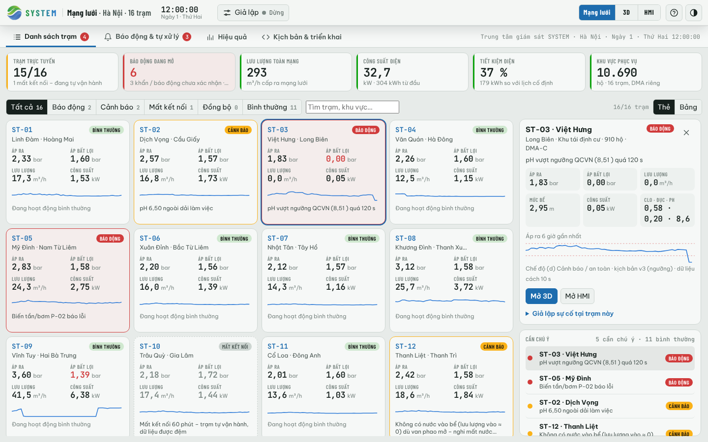

# 08 – Mạng lưới trạm bơm SYSTEM tại Hà Nội (màn "Mạng lưới")

Bản web mở đầu bằng **màn Mạng lưới**: trung tâm giám sát của SYSTEM nhìn toàn bộ 16 trạm bơm tăng áp giả lập ở Hà Nội. Mỗi trạm
là một mô phỏng đầy đủ (vật lý, cảm biến, edge gateway, lớp an toàn, đường truyền 4G) và cùng báo về **một máy chủ** – nên các số đo
trên màn này là bản đo xa mà trung tâm *thực sự* nhận được (đứng yên khi trạm mất mạng), không phải số tô vẽ. Nhấp vào một trạm để xuống màn chi tiết 3D hoặc
HMI y như bản một trạm.

> Toàn bộ vị trí, số hộ, sự cố là **dữ liệu giả lập để trình diễn** (khu vực chỉ mang tính minh họa, không phải điểm triển khai
> thật).

## Mở và điều hướng

| Muốn | Thao tác |
|---|---|
| Vào màn Mạng lưới | Mở `…/web/` (mặc định), nút **Mạng lưới** trên thanh trên, hoặc bấm logo SYSTEM |
| Mở thẳng một trạm | `…/web/#ST-05` (3D), `…/web/#ST-05-hmi` (HMI); mở toàn mạng: `#H1` hoặc `#fleet` |
| Mở bài học một trạm như trước | `…/web/#S4-advanced` (các bài S0…S13 vẫn chạy trên ST-01) |
| Xem chi tiết trạm | Nhấp thẻ (hoặc dòng trong bảng) rồi **Mở 3D** / **Mở HMI** ở cột phải; nhấp đúp thẻ hoặc dòng, hoặc nhấp mã trạm, để mở thẳng |
| Đổi trạm khi đang xem chi tiết | Ô chọn trạm và hai nút ‹ › trên thanh trên |
| Gây sự cố để xem hệ thống phản ứng | Chọn một thẻ → **Giả lập sự cố tại trạm này** ở cột phải, hoặc mục **Sự cố** ở màn chi tiết |

Tốc độ mặc định ×300 (1 giờ mô phỏng ≈ 12 giây) để thấy hết kịch bản sự cố trong vài phút; chỉnh bằng dải ×1…×3600 trên thanh trên.

## Bốn màn

1. **Danh sách trạm** – màn mở đầu, có hai kiểu xem; nút **Thẻ | Bảng** ở góc phải nhớ lựa chọn cho lần mở sau. Thanh lọc theo trạng
   thái và ô tìm kiếm dùng chung cho cả hai kiểu.
   - **Thẻ** (mặc định) – mỗi trạm một thẻ: mã trạm, khu vực, trạng thái, áp ra, áp bất lợi (logger PL-301), lưu lượng, công suất,
     đường áp 6 giờ và một dòng lý do (đang bình thường / báo động nào / mất kết nối bao lâu). Trạm bình thường để trung tính; báo
     động viền đỏ, cảnh báo viền vàng, đang đồng bộ viền xanh, mất kết nối viền nét đứt và số liệu xám (số đo cuối cùng máy chủ nhận).
     Thẻ xếp cố định theo mã trạm nên không nhảy chỗ khi trạng thái đổi. Cột phải gồm thẻ chi tiết của trạm đang chọn (đủ số đo, đường
     áp 6 giờ, chế độ, kịch bản, **Mở 3D** / **Mở HMI**, **Giả lập sự cố tại trạm này**) và danh sách **Cần chú ý** (trạm
     nặng nhất lên đầu, kèm lý do). Màn hẹp: cột phải chuyển lên trên lưới thẻ.
   - **Bảng** – 16 trạm: trạng thái, chế độ gateway (a/b/c/d), áp, lưu lượng, mức bể, công suất, clo/đục/pH, tiết kiệm điện so với
     lịch cố định, báo động, đường áp 6 giờ. Sắp theo cột.
2. **Báo động & tự xử lý** – báo động tập trung (xác nhận, "Đặt lại" dừng an toàn) và dòng sự kiện "hệ thống đã tự xử lý": tự chuyển
   bơm dự phòng, dừng an toàn, tự vận hành khi mất mạng, PID nội biến tần khi mini PC treo, đồng bộ lại, lệnh từ trung tâm. Các thẻ
   tổng hợp cho biết bao nhiêu báo động tự hết, bao nhiêu cần điều độ viên, các trạm đã tự vận hành bao nhiêu phút và số bản ghi đệm
   được phát lại đủ.
3. **Hiệu quả** – điện năng tiết kiệm (kWh, %, tiền theo giá giả định), suất điện năng, rò rỉ, thời gian đạt dải áp, thời gian phát hiện
   sự cố so với lịch cố định; biểu đồ công suất, lưu lượng, số trạm đạt dải áp toàn mạng; xếp hạng tiết kiệm theo trạm.
4. **Kịch bản & triển khai** – phát hành kịch bản từ trung tâm tới tất cả / các trạm đã chọn / các trạm bình thường: đổi sang điều khiển dự
   báo, hạ áp đặt tối đa, tăng biên áp khi mất mạng, hoặc **thử giá trị sai** để thấy gateway từ chối. Bảng cho biết từng trạm đã áp
   dụng phiên bản nào; trạm đang mất mạng nhận khi đồng bộ lại (bản tin retained).

Nhấp một trạm để xuống màn chi tiết – cảnh 3D (có bảng hiệu SYSTEM trên tường trạm), HMI SCADA và mọi bảng như bản một trạm:

## Kịch bản H1 – sự cố rải trên nhiều trạm

Mỗi trạm tự xử lý tại chỗ; trung tâm chỉ theo dõi và can thiệp khi cần. Mốc giờ tính từ lúc bắt đầu (Thứ Hai 00:00).

| Giờ | Trạm | Sự cố |
|---:|---|---|
| 0,6 h | ST-06 · Xuân Đỉnh | Mất kết nối 4G → chế độ (b), đệm dữ liệu; 2,8 h có lại → đồng bộ (c) |
| 1,2 h | ST-14 · Ngọc Thụy | Vỡ ống nhánh 9 m³/h (đến 5,5 h) |
| 2,5 h | ST-11 · Cổ Loa | Cảm biến áp PT-101 kẹt (sửa 4,5 h) |
| 3,2 h | ST-13 · Tây Mỗ | Hỏng bơm P-01 → chuyển P-02 (sửa 8 h) |
| 4 h | ST-04 · Văn Quán | Mini PC treo → watchdog, PID nội biến tần; 6,5 h khởi động lại |
| 5 h | ST-09 · Vĩnh Tuy | Nước nguồn đục 15 NTU (đến 8 h) → dừng an toàn; 8,5 h trung tâm xả bể, 10,5 h đặt lại |
| 5 h | ST-16 · Láng Hạ | Mất kết nối 4G (đến 9 h) |
| 6 h | ST-02 · Dịch Vọng | pH nguồn 4,8 (đến 13 h) |
| 7 h | ST-08 · Khương Đình | Nhu cầu tăng ×1,6 (đến 9 h) |
| 8 h | ST-12 · Thanh Liệt | Mất nước nguồn (đến 12 h) |
| 8 h | ST-03 · Việt Hưng | pH nguồn 9,8 (đến 16 h) |
| 10 h | ST-05 · Mỹ Đình | Hỏng bơm P-02 (sửa 13 h) |
| 11 h | ST-10 · Trâu Quỳ | Mất kết nối 4G (đến 14 h) |

Các bài học S0…S13 không có sự cố nền này: chúng chạy riêng trên ST-01 như cũ, các trạm khác vẫn được mô phỏng nhưng không có sự cố.

## Dữ liệu: `config/hanoi.json`

- `sites[]` – mỗi trạm: `id`, `area` (khu vực), `district`, `kind`, `zone` (DMA), `lat`/`lon`, `demand_scale`, `dz_crit_m`, `seed_offset`,
  `households`. **ST-01…ST-04 giữ đúng tham số vật lý trong `station.json`** (kiểm thử `tests/test_fleet_js.py`), nên kết quả bài học
  và tài liệu cũ không đổi.
- `scenario` – kịch bản H1 (mỗi sự kiện có thêm trường `station`).
- `map` – hộp kinh/vĩ độ bao các trạm (kiểm thử dữ liệu dùng; giao diện không còn vẽ bản đồ); `tariff_vnd_per_kwh` – giá điện bình quân **giả định** để quy đổi tiền.

Bản web ghép `hanoi.json` vào cấu hình bằng `web/js/sim/fleet.js` (`applyFleet`). Lõi Python và `station.json` giữ nguyên (4 trạm), nên
`python -m trambom …` không đổi. Thêm một trạm: thêm một mục vào `sites[]` với `id` mới, `seed_offset` riêng, toạ độ trong `map`.

## Giả định và giới hạn

- Các trạm cùng một kiểu (2 bơm 5,5 kW, bể ≈ 190 m³); khác nhau ở nhu cầu, độ cao điểm bất lợi và hạt giống ngẫu nhiên.
- Số đo lấy từ bản đo xa MQTT (chu kỳ 10 s). Hai thông tin đi đường khác: áp điểm bất lợi do logger NB-IoT PL-301 đo (độc lập với 4G
  của gateway) và việc "mini PC ngừng" (router 4G còn sống nhưng không còn nhịp tim MQTT).
- "Tiết kiệm điện" so với lịch cố định chạy song song, chỉ hiện sau 6 giờ mô phỏng (lịch cố định tắt bơm ban đêm nên vài giờ đầu cho tỉ lệ vô nghĩa); có thể âm ở trạm mà lịch cố định ngừng cấp nước do sự cố (tốn ít điện hơn nhưng mất dịch vụ).
- Tiền điện chỉ để minh họa; mô hình chưa có giá điện theo giờ.
