# Kết quả so sánh: lịch cố định và điều khiển thông minh

Tệp này được sinh tự động bởi `python -m trambom compare` (bước thời gian 1,0 s, hạt giống ngẫu nhiên 20261029). Ba phương án chạy song song với **cùng một chuỗi nhu cầu, nguồn nước và sự cố**.

## S1 · Vận hành bình thường có kết nối

Một ngày làm việc điển hình. Gateway duy trì áp theo lưu lượng, máy chủ nhận dữ liệu liên tục.

| Chỉ số | Lịch cố định | Thông minh – cơ bản (ngưỡng) | Thông minh – nâng cao (dự báo) |
|---|---:|---:|---:|
| Điện năng tiêu thụ (kWh) | 74,0 | 44,9 | 43,6 |
| Tiết kiệm so với lịch cố định | – | 39,3 % | 41,1 % |
| Suất điện năng (kWh/m³ cấp vào mạng) | 0,178 | 0,104 | 0,102 |
| Nước cấp vào mạng (m³) | 415 | 430 | 428 |
| Rò rỉ trên mạng (m³) | 46,7 | 38,1 | 36,7 |
| Thiếu nước thực sự – bồn mái cạn (m³) | 0,0 | 0,0 | 0,0 |
| Áp lực ngoài dải – tổng (phút) | 777 | 0 | 0 |
|   · áp điểm bất lợi < 1,4 bar (phút) | 475 | 0 | 0 |
|   · áp đầu ra > 4,0 bar (phút) | 302 | 0 | 0 |
| Thời gian đạt dải áp (%) | 46,0 | 100,0 | 100,0 |
| Áp đầu ra lớn nhất (bar) | 4,29 | 3,66 | 3,61 |
| Số đợt cấp nước không đạt QCVN | 0 | 0 | 0 |
| Lượng nước không đạt QCVN đã cấp (m³) | 0,0 | 0,0 | 0,0 |
| Số lần khởi động bơm (P-01 + P-02) | 3 (1 + 2) | 2 (0 + 2) | 3 (0 + 3) |
| Giờ chạy P-01 / P-02 (h) | 17,0 / 5,0 | 24,0 / 2,2 | 24,0 / 4,7 |
| Thời gian bơm chạy khô (phút) | 0,0 | 0,0 | 0,0 |
| Thời gian phát hiện sự cố | – | – | – |

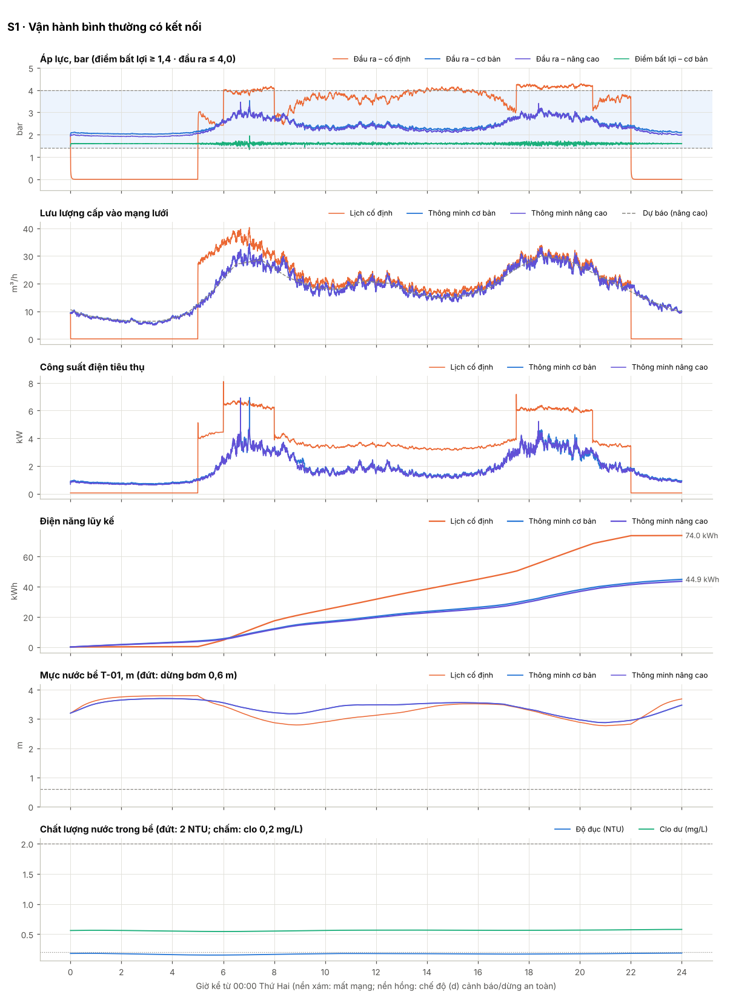

Diễn biến chính (mức nâng cao)

- `N1 06:40` Ghép bơm thứ hai sớm theo dự báo
- `N1 08:54` Tách bơm – một bơm đủ đáp ứng
- `N1 18:22` Ghép bơm thứ hai sớm theo dự báo
- `N1 20:48` Tách bơm – một bơm đủ đáp ứng
- `N1 23:59` Luân phiên bơm: P-01 → P-02 (đủ 24 h chạy)

## S2 · Mất mạng 8 giờ – gateway tự vận hành

Kết nối 4G mất từ 08:00 đến 16:00. Gateway phát hiện mất mạng sau 60 s, cộng biên an toàn áp lực, lưu đệm dữ liệu.

| Chỉ số | Lịch cố định | Thông minh – cơ bản (ngưỡng) | Thông minh – nâng cao (dự báo) |
|---|---:|---:|---:|
| Điện năng tiêu thụ (kWh) | 74,0 | 45,8 | 44,5 |
| Tiết kiệm so với lịch cố định | – | 38,1 % | 39,8 % |
| Suất điện năng (kWh/m³ cấp vào mạng) | 0,178 | 0,106 | 0,104 |
| Nước cấp vào mạng (m³) | 415 | 431 | 429 |
| Rò rỉ trên mạng (m³) | 46,7 | 38,9 | 37,4 |
| Thiếu nước thực sự – bồn mái cạn (m³) | 0,0 | 0,0 | 0,0 |
| Áp lực ngoài dải – tổng (phút) | 777 | 0 | 0 |
|   · áp điểm bất lợi < 1,4 bar (phút) | 475 | 0 | 0 |
|   · áp đầu ra > 4,0 bar (phút) | 302 | 0 | 0 |
| Thời gian đạt dải áp (%) | 46,0 | 100,0 | 100,0 |
| Áp đầu ra lớn nhất (bar) | 4,29 | 3,66 | 3,61 |
| Số đợt cấp nước không đạt QCVN | 0 | 0 | 0 |
| Lượng nước không đạt QCVN đã cấp (m³) | 0,0 | 0,0 | 0,0 |
| Số lần khởi động bơm (P-01 + P-02) | 3 (1 + 2) | 2 (0 + 2) | 3 (0 + 3) |
| Giờ chạy P-01 / P-02 (h) | 17,0 / 5,0 | 24,0 / 2,4 | 24,0 / 5,0 |
| Thời gian bơm chạy khô (phút) | 0,0 | 0,0 | 0,0 |
| Thời gian phát hiện sự cố | – | – | – |

| Chỉ số truyền thông & đồng bộ | Cơ bản | Nâng cao |
|---|---:|---:|
| Thời gian mất mạng (phút) | 479 | 479 |
| Bản ghi đo xa sinh ra | 8639 | 8639 |
| Độ đầy bộ đệm lớn nhất (%) | 66,7 | 66,7 |
| Số lần nén bộ đệm | 0 | 0 |
| Bản ghi bị mất do tràn | 0 | 0 |
| Độ đầy đủ dữ liệu tại máy chủ (%) | 100,0 | 100,0 |
| Bản ghi đến muộn (phát lại sau đồng bộ) | 2876 | 2876 |
| Số xung đột tham số đã giải quyết | 0 | 0 |
| SMS dự phòng đã gửi | 0 | 0 |
| Dữ liệu lên / xuống (kB) | 2444 / 692 | 2444 / 692 |
| Sai số dự báo MAPE (%) | 5,1 | 5,3 |

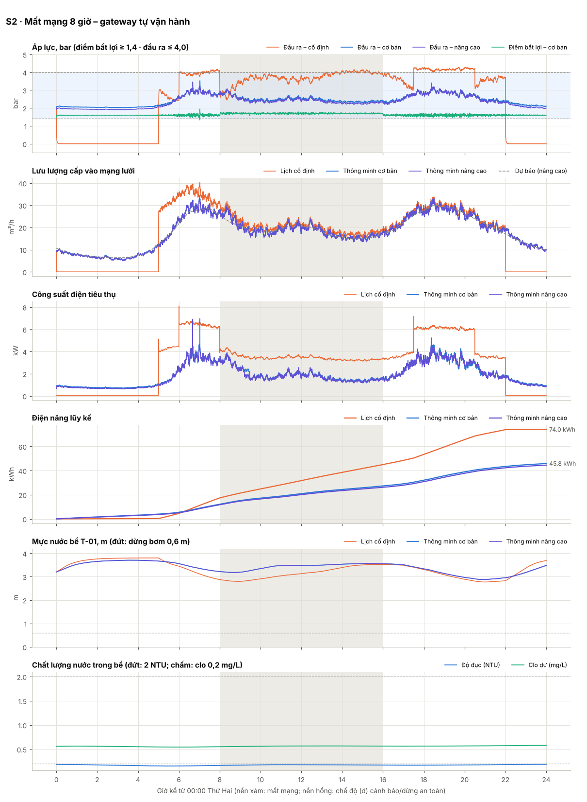

Diễn biến chính (mức nâng cao)

- `N1 06:40` Ghép bơm thứ hai sớm theo dự báo
- `N1 08:00` Mất kết nối máy chủ > 60 s – chuyển chế độ (b) tự vận hành bằng kịch bản v3 đã lưu
- `N1 08:00` BÁO ĐỘNG [COMMS_OFFLINE] Mất kết nối máy chủ điều hành
- `N1 09:12` Tách bơm – một bơm đủ đáp ứng
- `N1 16:00` Khôi phục kết nối sau 479.1 phút – chế độ (c) đồng bộ: gửi bản tin chào, 2881 bản ghi đệm
- `N1 16:00` Hiệu chỉnh đồng hồ gateway: lệch 0.15 s sau thời gian mất mạng
- `N1 16:02` Đồng bộ hoàn tất sau 144 s – trở lại chế độ (a) bình thường
- `N1 18:22` Ghép bơm thứ hai sớm theo dự báo
- `N1 20:48` Tách bơm – một bơm đủ đáp ứng
- `N1 23:59` Luân phiên bơm: P-01 → P-02 (đủ 24 h chạy)

## S3 · Khôi phục kết nối, đồng bộ và xử lý xung đột

Mất mạng 06:00–14:00. Trong lúc đó: trung tâm gửi lệnh ghi đè (hết hạn), kỹ thuật viên sửa tham số tại HMI, trung tâm phát hành kịch bản v4. Khi có mạng lại: hợp nhất 3 chiều, phát lại dữ liệu đệm.

| Chỉ số | Lịch cố định | Thông minh – cơ bản (ngưỡng) | Thông minh – nâng cao (dự báo) |
|---|---:|---:|---:|
| Điện năng tiêu thụ (kWh) | 74,0 | 48,8 | 44,7 |
| Tiết kiệm so với lịch cố định | – | 34,1 % | 39,6 % |
| Suất điện năng (kWh/m³ cấp vào mạng) | 0,178 | 0,113 | 0,104 |
| Nước cấp vào mạng (m³) | 415 | 432 | 429 |
| Rò rỉ trên mạng (m³) | 46,7 | 40,4 | 37,4 |
| Thiếu nước thực sự – bồn mái cạn (m³) | 0,0 | 0,0 | 0,0 |
| Áp lực ngoài dải – tổng (phút) | 777 | 0 | 0 |
|   · áp điểm bất lợi < 1,4 bar (phút) | 475 | 0 | 0 |
|   · áp đầu ra > 4,0 bar (phút) | 302 | 0 | 0 |
| Thời gian đạt dải áp (%) | 46,0 | 100,0 | 100,0 |
| Áp đầu ra lớn nhất (bar) | 4,29 | 3,72 | 3,60 |
| Số đợt cấp nước không đạt QCVN | 0 | 0 | 0 |
| Lượng nước không đạt QCVN đã cấp (m³) | 0,0 | 0,0 | 0,0 |
| Số lần khởi động bơm (P-01 + P-02) | 3 (1 + 2) | 3 (1 + 2) | 3 (1 + 2) |
| Giờ chạy P-01 / P-02 (h) | 17,0 / 5,0 | 17,7 / 13,2 | 16,5 / 12,6 |
| Thời gian bơm chạy khô (phút) | 0,0 | 0,0 | 0,0 |
| Thời gian phát hiện sự cố | – | – | – |

| Chỉ số truyền thông & đồng bộ | Cơ bản | Nâng cao |
|---|---:|---:|
| Thời gian mất mạng (phút) | 479 | 479 |
| Bản ghi đo xa sinh ra | 8639 | 8639 |
| Độ đầy bộ đệm lớn nhất (%) | 66,7 | 66,7 |
| Số lần nén bộ đệm | 0 | 0 |
| Bản ghi bị mất do tràn | 0 | 0 |
| Độ đầy đủ dữ liệu tại máy chủ (%) | 100,0 | 100,0 |
| Bản ghi đến muộn (phát lại sau đồng bộ) | 2876 | 2876 |
| Số xung đột tham số đã giải quyết | 2 | 2 |
| SMS dự phòng đã gửi | 0 | 0 |
| Dữ liệu lên / xuống (kB) | 2444 / 693 | 2444 / 693 |
| Sai số dự báo MAPE (%) | 5,2 | 5,3 |

Hợp nhất kịch bản khi đồng bộ (mức nâng cao):

| Tham số | Gốc | Máy chủ | Tại chỗ | Kết quả | Quy tắc |
|---|---:|---:|---:|---:|---|
| `alternation.runtime_h` | 24.0 | 12.0 | 48.0 | **12.0** | tham số vận hành → máy chủ thắng, chuyển điều độ viên rà soát |
| `pressure.p_crit_target_bar` | 1.6 | 1.55 | 1.7 | **1.7** | tham số dịch vụ/an toàn → chọn giá trị bảo thủ (lớn hơn) |
| `pressure.kp_hz_per_bar` | | | | 9.0 | chỉ máy chủ thay đổi |
| `staging.t_on_s` | | | | 30.0 | chỉ tại chỗ thay đổi |

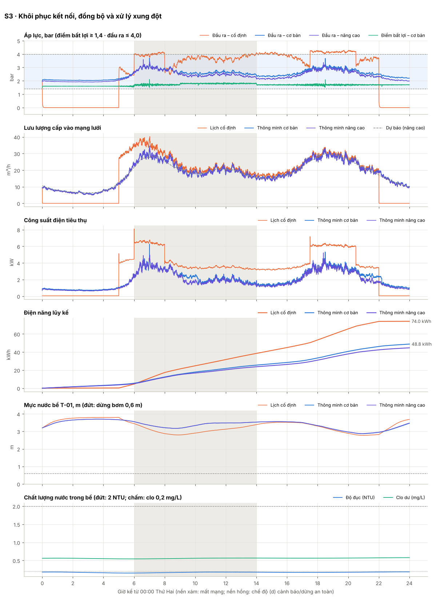

Diễn biến chính (mức nâng cao)

- `N1 06:00` Mất kết nối máy chủ > 60 s – chuyển chế độ (b) tự vận hành bằng kịch bản v3 đã lưu
- `N1 06:00` BÁO ĐỘNG [COMMS_OFFLINE] Mất kết nối máy chủ điều hành
- `N1 06:35` Ghép bơm thứ hai sớm theo dự báo
- `N1 09:00` HMI tại trạm (KTV tại trạm (HMI)): pressure.p_crit_target_bar=1.7, staging.t_on_s=30.0, alternation.runtime_h=48.0
- `N1 09:12` Tách bơm – một bơm đủ đáp ứng
- `N1 14:00` Khôi phục kết nối sau 479.1 phút – chế độ (c) đồng bộ: gửi bản tin chào, 2881 bản ghi đệm
- `N1 14:00` Hiệu chỉnh đồng hồ gateway: lệch 0.15 s sau thời gian mất mạng
- `N1 14:00` Xung đột alternation.runtime_h: server=12.0, tại chỗ=48.0 → 12.0 (tham số vận hành → máy chủ thắng, chuyển điều độ viên rà soát)
- `N1 14:00` Xung đột pressure.p_crit_target_bar: server=1.55, tại chỗ=1.7 → 1.7 (tham số dịch vụ/an toàn → chọn giá trị bảo thủ (lớn hơn))
- `N1 14:00` Áp dụng kịch bản v5 (đồng bộ sau mất mạng, predictive) – giám sát 10 phút trước khi xác nhận
- `N1 14:00` Lệnh từ xa rotate_pumps (đồng bộ): sẽ luân phiên bơm
- `N1 14:00` Luân phiên bơm: P-01 → P-02 (theo lệnh)
- `N1 14:02` Đồng bộ hoàn tất sau 144 s – trở lại chế độ (a) bình thường
- `N1 14:10` Kịch bản v5 vận hành ổn định 10 phút – xác nhận (commit)
- `N1 18:22` Ghép bơm thứ hai sớm theo dự báo
- `N1 20:48` Tách bơm – một bơm đủ đáp ứng

## S3b · Kịch bản mới bị lỗi – tự động quay lui

06:15 trung tâm phát hành kịch bản v4 với hệ số PI quá nhỏ (chưa kiểm thử). Gateway áp dụng có giám sát 10 phút. Mức cơ bản: áp lệch xa điểm đặt khi nhu cầu tăng, gateway tự quay lui. Mức nâng cao: bù trước che lỗi trong 10 phút nên kịch bản được xác nhận, rồi gây quá áp khi ghép bơm lúc 06:40 – minh họa giới hạn của tiêu chí giám sát.

| Chỉ số | Lịch cố định | Thông minh – cơ bản (ngưỡng) | Thông minh – nâng cao (dự báo) |
|---|---:|---:|---:|
| Điện năng tiêu thụ (kWh) | 31,7 | 20,3 | 21,5 |
| Tiết kiệm so với lịch cố định | – | 36,1 % | 32,1 % |
| Suất điện năng (kWh/m³ cấp vào mạng) | 0,168 | 0,107 | 0,113 |
| Nước cấp vào mạng (m³) | 188 | 190 | 191 |
| Rò rỉ trên mạng (m³) | 17,2 | 18,7 | 19,0 |
| Thiếu nước thực sự – bồn mái cạn (m³) | 0,0 | 0,0 | 0,0 |
| Áp lực ngoài dải – tổng (phút) | 400 | 4 | 0 |
|   · áp điểm bất lợi < 1,4 bar (phút) | 355 | 4 | 0 |
|   · áp đầu ra > 4,0 bar (phút) | 46 | 0 | 0 |
| Thời gian đạt dải áp (%) | 44,4 | 99,5 | 100,0 |
| Áp đầu ra lớn nhất (bar) | 4,17 | 3,66 | 4,06 |
| Số đợt cấp nước không đạt QCVN | 0 | 0 | 0 |
| Lượng nước không đạt QCVN đã cấp (m³) | 0,0 | 0,0 | 0,0 |
| Số lần khởi động bơm (P-01 + P-02) | 2 (1 + 1) | 1 (0 + 1) | 1 (0 + 1) |
| Giờ chạy P-01 / P-02 (h) | 7,0 / 2,0 | 12,0 / 2,2 | 12,0 / 2,5 |
| Thời gian bơm chạy khô (phút) | 0,0 | 0,0 | 0,0 |
| Thời gian phát hiện sự cố | – | – | – |

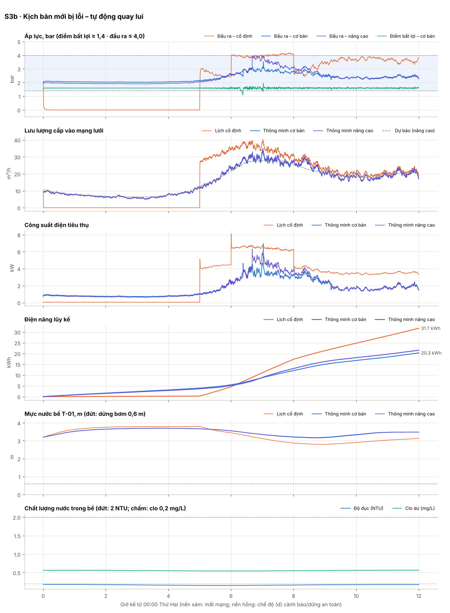

Diễn biến chính (mức nâng cao)

- `N1 06:15` Áp dụng kịch bản v4 (phát hành trực tuyến, predictive) – giám sát 10 phút trước khi xác nhận
- `N1 06:25` Kịch bản v4 vận hành ổn định 10 phút – xác nhận (commit)
- `N1 06:40` Ghép bơm thứ hai sớm theo dự báo
- `N1 06:40` BÁO ĐỘNG [P_HIGH] Áp lực đầu ra 4.03 bar > 4.0 bar – giới hạn tần số bơm
- `N1 09:13` Tách bơm – một bơm đủ đáp ứng

## S4 · Sự cố độ đục – cảnh báo và dừng an toàn

Nước nguồn bị đục 12 NTU từ 13:00 đến 16:00. Độ đục trong bể tăng dần; gateway cảnh báo ở 1 NTU, dừng an toàn khi > 2 NTU kéo dài 60 s, đóng van đầu ra. Trung tâm ra lệnh xả bể và đặt lại khi chất lượng đạt.

| Chỉ số | Lịch cố định | Thông minh – cơ bản (ngưỡng) | Thông minh – nâng cao (dự báo) |
|---|---:|---:|---:|
| Điện năng tiêu thụ (kWh) | 74,0 | 44,0 | 42,9 |
| Tiết kiệm so với lịch cố định | – | 40,5 % | 42,1 % |
| Suất điện năng (kWh/m³ cấp vào mạng) | 0,178 | 0,118 | 0,115 |
| Nước cấp vào mạng (m³) | 415 | 374 | 373 |
| Rò rỉ trên mạng (m³) | 46,7 | 31,2 | 30,1 |
| Thiếu nước thực sự – bồn mái cạn (m³) | 0,0 | 0,0 | 0,0 |
| Áp lực ngoài dải – tổng (phút) | 777 | 320 | 318 |
|   · áp điểm bất lợi < 1,4 bar (phút) | 475 | 320 | 318 |
|   · áp đầu ra > 4,0 bar (phút) | 302 | 0 | 0 |
| Thời gian đạt dải áp (%) | 46,0 | 77,8 | 77,9 |
| Áp đầu ra lớn nhất (bar) | 4,29 | 3,66 | 3,97 |
| Số đợt cấp nước không đạt QCVN | 1 | 1 | 1 |
| Lượng nước không đạt QCVN đã cấp (m³) | 65,5 | 0,4 | 0,5 |
| Số lần khởi động bơm (P-01 + P-02) | 3 (1 + 2) | 3 (1 + 2) | 3 (1 + 2) |
| Giờ chạy P-01 / P-02 (h) | 17,0 / 5,0 | 19,1 / 6,1 | 19,1 / 6,2 |
| Thời gian bơm chạy khô (phút) | 0,0 | 0,0 | 0,0 |
| Thời gian phát hiện sự cố | không phát hiện | 42 phút | 43 phút |

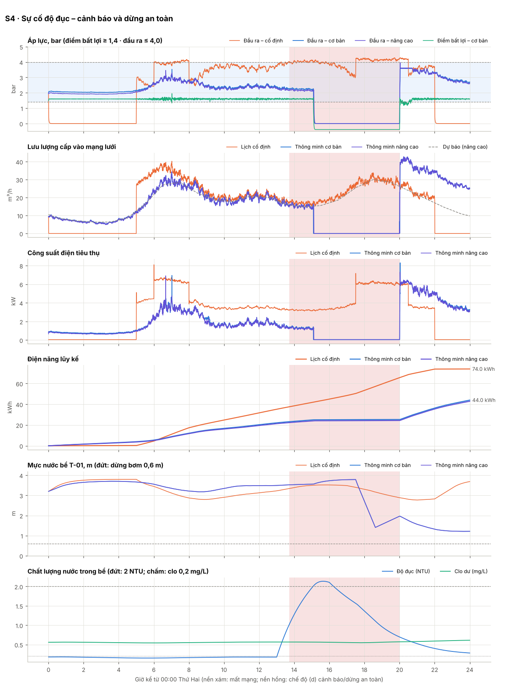

Diễn biến chính (mức nâng cao)

- `N1 06:40` Ghép bơm thứ hai sớm theo dự báo
- `N1 08:54` Tách bơm – một bơm đủ đáp ứng
- `N1 13:42` BÁO ĐỘNG [NTU_WARN] Độ đục 1.00 NTU ngoài dải làm việc
- `N1 15:06` BÁO ĐỘNG [NTU_TRIP] Độ đục vượt ngưỡng QCVN (2.01 NTU) quá 60 s
- `N1 15:06` BÁO ĐỘNG [SAFE_STOP] DỪNG AN TOÀN: Độ đục không đạt – dừng bơm, đóng van MV-02
- `N1 15:06` Ưu tiên an toàn: chặn lệnh chạy 1 bơm của kịch bản (dừng an toàn do Độ đục)
- `N1 16:51` BÁO ĐỘNG [TTE_LOW] Dự báo bể cạn sau 6.0 h – chủ động giảm áp
- `N1 17:30` Lệnh từ xa flush_tank (trực tuyến): mở van xả VX-01 tới mức 1.4 m
- `N1 18:37` Xả bể kết thúc ở mức 1.40 m
- `N1 20:00` Kết thúc dừng an toàn (lệnh đặt lại) – mở van đầu ra, chạy lại bơm
- `N1 20:00` Lệnh từ xa reset_safe_stop (trực tuyến): Đã đặt lại dừng an toàn
- `N1 20:00` Cấp nước trở lại sau 293 phút ngừng – bồn mái nạp bù, tạm dừng học dự báo và phát hiện bất thường 7.3 h
- `N1 20:01` Ghép bơm thứ hai sớm theo dự báo

## S5 · Cảm biến áp lực PT-101 bị kẹt – áp lực vượt ngưỡng

09:00 PT-101 kẹt ở 2,1 bar. Vòng PI tăng tốc bơm, áp lực thực tăng. PT-102 độc lập kích hoạt bộ giới hạn áp cao; ở mức nâng cao, biểu quyết với mô hình bơm loại PT-101 tự động.

| Chỉ số | Lịch cố định | Thông minh – cơ bản (ngưỡng) | Thông minh – nâng cao (dự báo) |
|---|---:|---:|---:|
| Điện năng tiêu thụ (kWh) | 31,7 | 22,4 | 19,5 |
| Tiết kiệm so với lịch cố định | – | 29,4 % | 38,5 % |
| Suất điện năng (kWh/m³ cấp vào mạng) | 0,168 | 0,117 | 0,103 |
| Nước cấp vào mạng (m³) | 188 | 191 | 189 |
| Rò rỉ trên mạng (m³) | 17,2 | 19,8 | 17,9 |
| Thiếu nước thực sự – bồn mái cạn (m³) | 0,0 | 0,0 | 0,0 |
| Áp lực ngoài dải – tổng (phút) | 400 | 0 | 0 |
|   · áp điểm bất lợi < 1,4 bar (phút) | 355 | 0 | 0 |
|   · áp đầu ra > 4,0 bar (phút) | 46 | 0 | 0 |
| Thời gian đạt dải áp (%) | 44,4 | 99,9 | 100,0 |
| Áp đầu ra lớn nhất (bar) | 4,17 | 4,16 | 3,61 |
| Số đợt cấp nước không đạt QCVN | 0 | 0 | 0 |
| Lượng nước không đạt QCVN đã cấp (m³) | 0,0 | 0,0 | 0,0 |
| Số lần khởi động bơm (P-01 + P-02) | 2 (1 + 1) | 1 (0 + 1) | 1 (0 + 1) |
| Giờ chạy P-01 / P-02 (h) | 7,0 / 2,0 | 12,0 / 2,8 | 12,0 / 2,2 |
| Thời gian bơm chạy khô (phút) | 0,0 | 0,0 | 0,0 |
| Thời gian phát hiện sự cố | – | 0 phút | 0 phút |

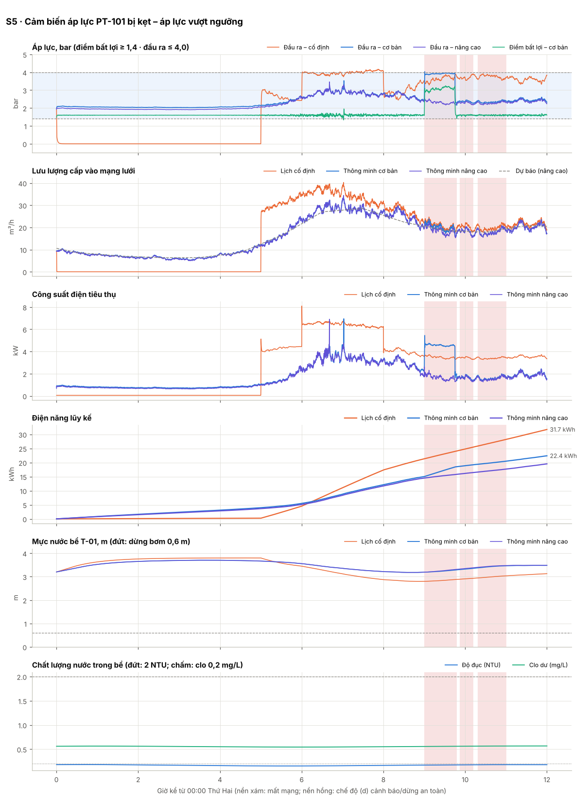

Diễn biến chính (mức nâng cao)

- `N1 06:40` Ghép bơm thứ hai sớm theo dự báo
- `N1 08:54` Tách bơm – một bơm đủ đáp ứng
- `N1 09:00` BÁO ĐỘNG [PT_DEVIATION] PT-101 (2.10) và PT-102 (2.59) lệch 0.49 bar
- `N1 09:00` Biểu quyết 2/3 với mô hình bơm (2.96 bar): loại PT-101 khỏi điều khiển
- `N1 09:00` Cảm biến áp lực cho điều khiển: PT-102
- `N1 09:45` Lệnh từ xa select_pt (trực tuyến): dùng PT-102 cho điều khiển
- `N1 10:53` BÁO ĐỘNG [PT_DEVIATION] PT-101 (2.10) và PT-102 (2.42) lệch 0.32 bar
- `N1 10:53` Biểu quyết 2/3 với mô hình bơm (2.42 bar): loại PT-101 khỏi điều khiển
- `N1 11:00` PT-101 khớp trở lại – đưa vào sử dụng

## S6 · Mất nước nguồn 10 giờ – mức bể thấp

Ống cấp thành phố ngừng cấp 09:00–19:00. Bể cạn dần; gateway giảm áp tiết kiệm, dừng bơm khi mức < 0,6 m để chống chạy khô. Mức nâng cao dự báo thời gian cạn bể và giảm áp sớm.

| Chỉ số | Lịch cố định | Thông minh – cơ bản (ngưỡng) | Thông minh – nâng cao (dự báo) |
|---|---:|---:|---:|
| Điện năng tiêu thụ (kWh) | 50,9 | 38,5 | 37,1 |
| Tiết kiệm so với lịch cố định | – | 24,3 % | 27,0 % |
| Suất điện năng (kWh/m³ cấp vào mạng) | 0,168 | 0,112 | 0,108 |
| Nước cấp vào mạng (m³) | 303 | 344 | 343 |
| Rò rỉ trên mạng (m³) | 27,9 | 29,4 | 28,1 |
| Thiếu nước thực sự – bồn mái cạn (m³) | 0,0 | 0,0 | 0,0 |
| Áp lực ngoài dải – tổng (phút) | 935 | 493 | 487 |
|   · áp điểm bất lợi < 1,4 bar (phút) | 889 | 493 | 487 |
|   · áp đầu ra > 4,0 bar (phút) | 46 | 0 | 0 |
| Thời gian đạt dải áp (%) | 35,1 | 65,8 | 66,2 |
| Áp đầu ra lớn nhất (bar) | 4,17 | 3,66 | 3,98 |
| Số đợt cấp nước không đạt QCVN | 0 | 0 | 0 |
| Lượng nước không đạt QCVN đã cấp (m³) | 0,0 | 0,0 | 0,0 |
| Số lần khởi động bơm (P-01 + P-02) | 5 (3 + 2) | 3 (1 + 2) | 3 (1 + 2) |
| Giờ chạy P-01 / P-02 (h) | 11,8 / 2,6 | 18,9 / 5,0 | 18,9 / 5,1 |
| Thời gian bơm chạy khô (phút) | 25,6 | 0,0 | 0,0 |
| Thời gian phát hiện sự cố | 450 phút | 14 phút | 14 phút |

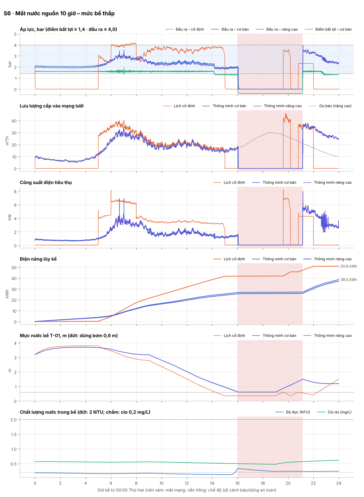

Diễn biến chính (mức nâng cao)

- `N1 06:40` Ghép bơm thứ hai sớm theo dự báo
- `N1 08:54` Tách bơm – một bơm đủ đáp ứng
- `N1 09:13` BÁO ĐỘNG [SUPPLY_LOST] Không có nước vào bể (lưu lượng vào ≈ 0) dù van phao mở – nghi mất nước nguồn
- `N1 09:27` BÁO ĐỘNG [TTE_LOW] Dự báo bể cạn sau 6.0 h – chủ động giảm áp
- `N1 14:12` BÁO ĐỘNG [LEVEL_LOW] Mức bể thấp (< 1.2 m) – giảm áp tiết kiệm nước
- `N1 16:04` BÁO ĐỘNG [LEVEL_STOP] Mức bể < 0.6 m – kịch bản dừng bơm chống chạy khô
- `N1 21:09` Mức bể hồi phục > 1.5 m – cho phép chạy bơm lại
- `N1 21:09` Cấp nước trở lại sau 305 phút ngừng – bồn mái nạp bù, tạm dừng học dự báo và phát hiện bất thường 7.6 h
- `N1 21:10` Ghép bơm thứ hai (bơm chính đã max tần số)
- `N1 22:52` BÁO ĐỘNG [LEVEL_LOW] Mức bể thấp (< 1.2 m) – giảm áp tiết kiệm nước

## S7 · Hỏng bơm P-01 giờ cao điểm – chuyển bơm dự phòng

07:45 biến tần VFD-01 báo lỗi (ngay sau lượt kiểm tra 07:30 của công nhân). Gateway chuyển sang P-02 trong vài giây. Phương án lịch cố định chỉ phát hiện ở lượt kiểm tra 16:30. Đội sửa chữa thay biến tần lúc 20:00.

| Chỉ số | Lịch cố định | Thông minh – cơ bản (ngưỡng) | Thông minh – nâng cao (dự báo) |
|---|---:|---:|---:|
| Điện năng tiêu thụ (kWh) | 42,3 | 44,6 | 43,3 |
| Tiết kiệm so với lịch cố định | – | -5,5 % | -2,4 % |
| Suất điện năng (kWh/m³ cấp vào mạng) | 0,156 | 0,104 | 0,101 |
| Nước cấp vào mạng (m³) | 271 | 430 | 428 |
| Rò rỉ trên mạng (m³) | 14,5 | 38,1 | 36,7 |
| Thiếu nước thực sự – bồn mái cạn (m³) | 0,0 | 0,0 | 0,0 |
| Áp lực ngoài dải – tổng (phút) | 1232 | 1 | 0 |
|   · áp điểm bất lợi < 1,4 bar (phút) | 1201 | 1 | 0 |
|   · áp đầu ra > 4,0 bar (phút) | 30 | 0 | 0 |
| Thời gian đạt dải áp (%) | 14,4 | 100,0 | 100,0 |
| Áp đầu ra lớn nhất (bar) | 4,15 | 3,66 | 3,61 |
| Số đợt cấp nước không đạt QCVN | 0 | 0 | 0 |
| Lượng nước không đạt QCVN đã cấp (m³) | 0,0 | 0,0 | 0,0 |
| Số lần khởi động bơm (P-01 + P-02) | 4 (2 + 2) | 1 (0 + 1) | 1 (0 + 1) |
| Giờ chạy P-01 / P-02 (h) | 3,3 / 7,5 | 7,8 / 17,0 | 7,8 / 17,3 |
| Thời gian bơm chạy khô (phút) | 0,0 | 0,0 | 0,0 |
| Thời gian phát hiện sự cố | 525 phút | 0 phút | 0 phút |

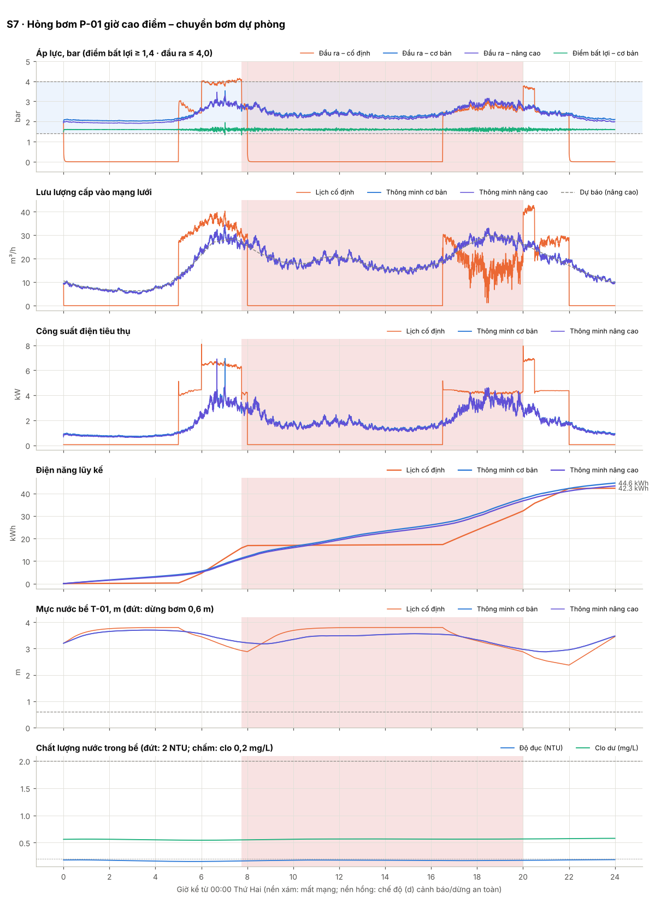

Diễn biến chính (mức nâng cao)

- `N1 06:40` Ghép bơm thứ hai sớm theo dự báo
- `N1 07:45` BÁO ĐỘNG [PUMP_FAULT_P-01] Biến tần/bơm P-01 báo lỗi
- `N1 07:45` Bơm P-01 lỗi – chuyển bơm dự phòng P-02 làm bơm chính

## S8 · Vỡ ống ban đêm – phát hiện bất thường lưu lượng

02:30 một ống nhánh bị vỡ (≈10 m³/h ở 2 bar). Mức nâng cao so sánh lưu lượng ban đêm với dự báo để cảnh báo rò rỉ; điều khiển theo ngưỡng chỉ thấy áp lực vẫn ổn.

| Chỉ số | Lịch cố định | Thông minh – cơ bản (ngưỡng) | Thông minh – nâng cao (dự báo) |
|---|---:|---:|---:|
| Điện năng tiêu thụ (kWh) | 77,6 | 58,2 | 57,4 |
| Tiết kiệm so với lịch cố định | – | 25,1 % | 26,0 % |
| Suất điện năng (kWh/m³ cấp vào mạng) | 0,169 | 0,114 | 0,113 |
| Nước cấp vào mạng (m³) | 460 | 511 | 510 |
| Rò rỉ trên mạng (m³) | 39,5 | 39,9 | 38,9 |
| Thiếu nước thực sự – bồn mái cạn (m³) | 0,0 | 0,0 | 0,0 |
| Áp lực ngoài dải – tổng (phút) | 910 | 34 | 34 |
|   · áp điểm bất lợi < 1,4 bar (phút) | 694 | 34 | 34 |
|   · áp đầu ra > 4,0 bar (phút) | 216 | 0 | 0 |
| Thời gian đạt dải áp (%) | 36,8 | 97,6 | 97,6 |
| Áp đầu ra lớn nhất (bar) | 4,24 | 3,67 | 3,67 |
| Số đợt cấp nước không đạt QCVN | 0 | 0 | 0 |
| Lượng nước không đạt QCVN đã cấp (m³) | 0,0 | 0,0 | 0,0 |
| Số lần khởi động bơm (P-01 + P-02) | 3 (1 + 2) | 2 (0 + 2) | 3 (0 + 3) |
| Giờ chạy P-01 / P-02 (h) | 17,0 / 5,0 | 24,0 / 4,2 | 24,0 / 6,7 |
| Thời gian bơm chạy khô (phút) | 0,0 | 0,0 | 0,0 |
| Thời gian phát hiện sự cố | không phát hiện | không phát hiện | 15 phút |

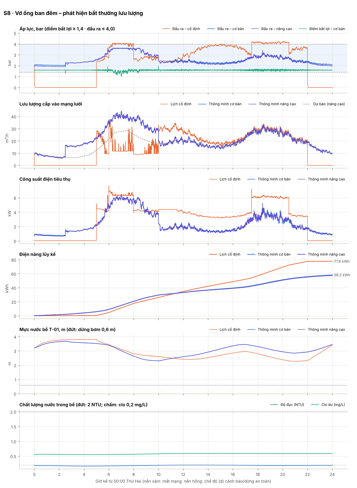

Diễn biến chính (mức nâng cao)

- `N1 02:44` BÁO ĐỘNG [FORECAST_FALLBACK] Sai số dự báo 35% > ngưỡng – tạm dùng điều khiển theo ngưỡng
- `N1 02:45` BÁO ĐỘNG [FLOW_ANOMALY] Lưu lượng cao hơn dự báo 8.9 m³/h kéo dài – nghi rò rỉ/vỡ ống
- `N1 05:54` Ghép bơm thứ hai (bơm chính đã max tần số)
- `N1 10:08` Tách bơm – một bơm đủ đáp ứng
- `N1 18:22` Ghép bơm thứ hai sớm theo dự báo
- `N1 20:48` Tách bơm – một bơm đủ đáp ứng
- `N1 23:59` Luân phiên bơm: P-01 → P-02 (đủ 24 h chạy)

## S9 · Tổng hợp DOK3: mất mạng dài + clo giảm + mất nguồn

Mất mạng 20 giờ (20:00 ngày 1 – 16:00 ngày 2). Trong lúc mất mạng: clo nước nguồn giảm còn 0,05 mg/L, nguồn cấp gián đoạn 4 giờ, kỹ thuật viên chỉnh tham số tại chỗ, trung tâm phát hành kịch bản mới. Gateway phải tự quyết định.

| Chỉ số | Lịch cố định | Thông minh – cơ bản (ngưỡng) | Thông minh – nâng cao (dự báo) |
|---|---:|---:|---:|
| Điện năng tiêu thụ (kWh) | 148,5 | 97,1 | 95,4 |
| Tiết kiệm so với lịch cố định | – | 34,6 % | 35,7 % |
| Suất điện năng (kWh/m³ cấp vào mạng) | 0,177 | 0,117 | 0,115 |
| Nước cấp vào mạng (m³) | 837 | 832 | 830 |
| Rò rỉ trên mạng (m³) | 90,1 | 69,7 | 67,3 |
| Thiếu nước thực sự – bồn mái cạn (m³) | 0,0 | 0,0 | 0,0 |
| Áp lực ngoài dải – tổng (phút) | 1429 | 496 | 482 |
|   · áp điểm bất lợi < 1,4 bar (phút) | 1012 | 496 | 482 |
|   · áp đầu ra > 4,0 bar (phút) | 417 | 0 | 0 |
| Thời gian đạt dải áp (%) | 50,4 | 82,8 | 83,3 |
| Áp đầu ra lớn nhất (bar) | 4,29 | 3,66 | 4,03 |
| Số đợt cấp nước không đạt QCVN | 1 | 1 | 1 |
| Lượng nước không đạt QCVN đã cấp (m³) | 29,0 | 1,4 | 2,5 |
| Số lần khởi động bơm (P-01 + P-02) | 6 (3 + 3) | 4 (1 + 3) | 5 (1 + 4) |
| Giờ chạy P-01 / P-02 (h) | 22,0 / 22,0 | 30,1 / 20,3 | 30,0 / 23,2 |
| Thời gian bơm chạy khô (phút) | 0,0 | 0,0 | 0,0 |
| Thời gian phát hiện sự cố | không phát hiện; không phát hiện | 416 phút; 33 phút | 421 phút; 3 phút |

| Chỉ số truyền thông & đồng bộ | Cơ bản | Nâng cao |
|---|---:|---:|
| Thời gian mất mạng (phút) | 1199 | 1199 |
| Bản ghi đo xa sinh ra | 17279 | 17279 |
| Độ đầy bộ đệm lớn nhất (%) | 80,0 | 80,0 |
| Số lần nén bộ đệm | 5 | 5 |
| Bản ghi bị mất do tràn | 0 | 0 |
| Độ đầy đủ dữ liệu tại máy chủ (%) | 100,0 | 100,0 |
| Bản ghi đến muộn (phát lại sau đồng bộ) | 7196 | 7196 |
| Số xung đột tham số đã giải quyết | 1 | 1 |
| SMS dự phòng đã gửi | 2 | 2 |
| Dữ liệu lên / xuống (kB) | 3763 / 1109 | 3763 / 1109 |
| Sai số dự báo MAPE (%) | 5,3 | 5,6 |

Hợp nhất kịch bản khi đồng bộ (mức nâng cao):

| Tham số | Gốc | Máy chủ | Tại chỗ | Kết quả | Quy tắc |
|---|---:|---:|---:|---:|---|
| `level.conserve_m` | 1.2 | 1.4 | 1.6 | **1.4** | tham số vận hành → máy chủ thắng, chuyển điều độ viên rà soát |
| `pressure.p_crit_target_bar` | | | | 1.55 | chỉ máy chủ thay đổi |

Diễn biến chính (mức nâng cao)

- `N1 06:40` Ghép bơm thứ hai sớm theo dự báo
- `N1 08:54` Tách bơm – một bơm đủ đáp ứng
- `N1 18:22` Ghép bơm thứ hai sớm theo dự báo
- `N1 20:00` Mất kết nối máy chủ > 60 s – chuyển chế độ (b) tự vận hành bằng kịch bản v3 đã lưu
- `N1 20:00` BÁO ĐỘNG [COMMS_OFFLINE] Mất kết nối máy chủ điều hành
- `N1 21:07` Tách bơm – một bơm đủ đáp ứng
- `N1 23:59` Luân phiên bơm: P-01 → P-02 (đủ 24 h chạy)
- `N2 02:00` HMI tại trạm (KTV tại trạm (HMI)): level.conserve_m=1.6
- `N2 05:01` BÁO ĐỘNG [CL_WARN] Clo dư 0.30 mg/L ngoài dải làm việc
- `N2 05:35` Bộ đệm đạt 80% – nén nửa dữ liệu cũ (gộp cặp bản ghi), còn 2595 bản ghi
- `N2 06:03` BÁO ĐỘNG [TTE_LOW] Dự báo bể cạn sau 5.9 h – chủ động giảm áp
- `N2 06:33` BÁO ĐỘNG [SUPPLY_LOST] Không có nước vào bể (lưu lượng vào ≈ 0) dù van phao mở – nghi mất nước nguồn
- `N2 07:59` Bộ đệm đạt 80% – nén nửa dữ liệu cũ (gộp cặp bản ghi), còn 2595 bản ghi
- `N2 10:22` Bộ đệm đạt 80% – nén nửa dữ liệu cũ (gộp cặp bản ghi), còn 2595 bản ghi
- `N2 11:10` BÁO ĐỘNG [CL_TRIP] Clo dư vượt ngưỡng QCVN (0.20 mg/L) quá 120 s
- `N2 11:10` Mất mạng IP – gửi SMS dự phòng tới tổ trực: Clo dư vượt ngưỡng QCVN (0.20 mg/L) quá 120 s
- `N2 11:10` BÁO ĐỘNG [SAFE_STOP] DỪNG AN TOÀN: Clo dư không đạt – dừng bơm, đóng van MV-02
- `N2 11:10` Mất mạng IP – gửi SMS dự phòng tới tổ trực: DỪNG AN TOÀN: Clo dư không đạt – dừng bơm, đóng van MV-02
- `N2 11:10` Ưu tiên an toàn: chặn lệnh chạy 1 bơm của kịch bản (dừng an toàn do Clo dư)
- `N2 12:46` Bộ đệm đạt 80% – nén nửa dữ liệu cũ (gộp cặp bản ghi), còn 2595 bản ghi
- `N2 15:09` Bộ đệm đạt 80% – nén nửa dữ liệu cũ (gộp cặp bản ghi), còn 2595 bản ghi
- `N2 16:00` Khôi phục kết nối sau 1199.2 phút – chế độ (c) đồng bộ: gửi bản tin chào, 2896 bản ghi đệm
- `N2 16:00` Hiệu chỉnh đồng hồ gateway: lệch 1.88 s sau thời gian mất mạng
- `N2 16:00` Xung đột level.conserve_m: server=1.4, tại chỗ=1.6 → 1.4 (tham số vận hành → máy chủ thắng, chuyển điều độ viên rà soát)
- `N2 16:00` Áp dụng kịch bản v5 (đồng bộ sau mất mạng, predictive) – giám sát 10 phút trước khi xác nhận
- `N2 16:02` Đồng bộ hoàn tất sau 145 s – trở lại chế độ (a) bình thường
- `N2 16:10` Kịch bản v5 vận hành ổn định 10 phút – xác nhận (commit)
- `N2 16:37` BÁO ĐỘNG [TTE_LOW] Dự báo bể cạn sau 6.0 h – chủ động giảm áp
- `N2 17:00` Kết thúc dừng an toàn (lệnh đặt lại) – mở van đầu ra, chạy lại bơm
- `N2 17:00` Lệnh từ xa reset_safe_stop (trực tuyến): Đã đặt lại dừng an toàn
- `N2 17:00` Cấp nước trở lại sau 350 phút ngừng – bồn mái nạp bù, tạm dừng học dự báo và phát hiện bất thường 8.7 h
- `N2 17:01` Ghép bơm thứ hai (bơm chính đã max tần số)
- `N2 23:02` Tách bơm – một bơm đủ đáp ứng

## S10 · Một tuần vận hành – so sánh điện năng

Bảy ngày (có cuối tuần). Dùng để so sánh kWh, kWh/m³, số lần khởi động bơm và để mô hình dự báo học mẫu sử dụng theo giờ và ngày.

| Chỉ số | Lịch cố định | Thông minh – cơ bản (ngưỡng) | Thông minh – nâng cao (dự báo) |
|---|---:|---:|---:|
| Điện năng tiêu thụ (kWh) | 527,4 | 317,1 | 307,5 |
| Tiết kiệm so với lịch cố định | – | 39,9 % | 41,7 % |
| Suất điện năng (kWh/m³ cấp vào mạng) | 0,174 | 0,105 | 0,102 |
| Nước cấp vào mạng (m³) | 3036 | 3019 | 3009 |
| Rò rỉ trên mạng (m³) | 310,5 | 267,4 | 257,2 |
| Thiếu nước thực sự – bồn mái cạn (m³) | 0,0 | 0,0 | 0,0 |
| Áp lực ngoài dải – tổng (phút) | 5292 | 1 | 0 |
|   · áp điểm bất lợi < 1,4 bar (phút) | 3631 | 1 | 0 |
|   · áp đầu ra > 4,0 bar (phút) | 1661 | 0 | 0 |
| Thời gian đạt dải áp (%) | 47,5 | 100,0 | 100,0 |
| Áp đầu ra lớn nhất (bar) | 4,39 | 3,68 | 3,73 |
| Số đợt cấp nước không đạt QCVN | 0 | 0 | 0 |
| Lượng nước không đạt QCVN đã cấp (m³) | 0,0 | 0,0 | 0,0 |
| Số lần khởi động bơm (P-01 + P-02) | 21 (10 + 11) | 15 (6 + 9) | 18 (7 + 11) |
| Giờ chạy P-01 / P-02 (h) | 83,1 / 71,1 | 106,9 / 84,7 | 107,9 / 91,1 |
| Thời gian bơm chạy khô (phút) | 0,0 | 0,0 | 0,0 |
| Thời gian phát hiện sự cố | – | – | – |

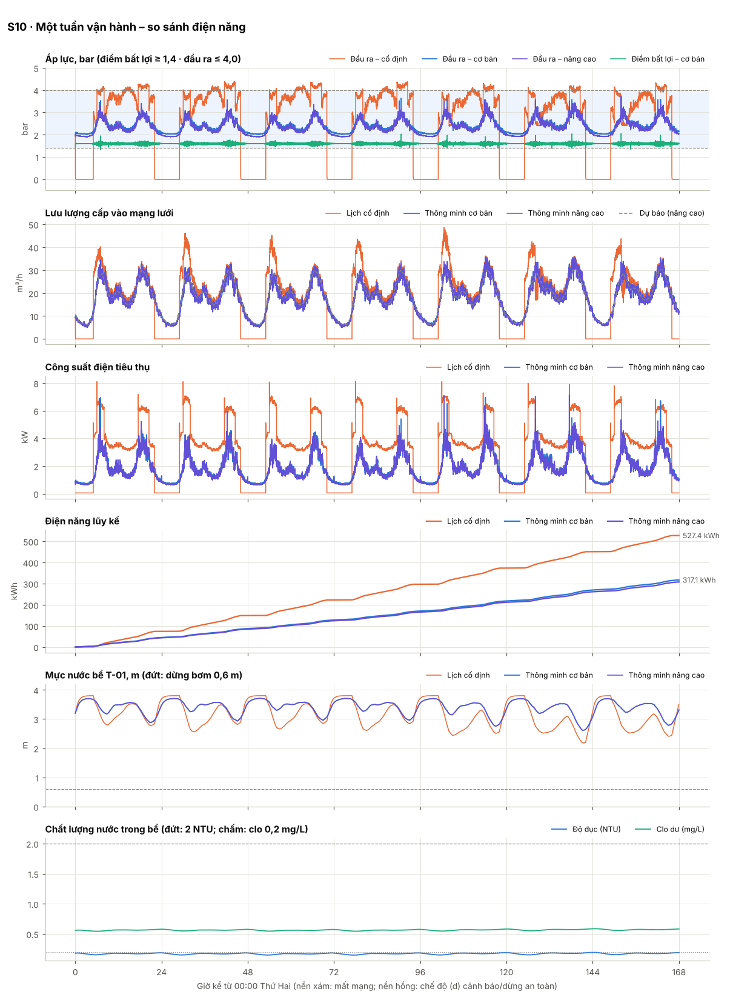

Diễn biến chính (mức nâng cao)

- `N1 06:40` Ghép bơm thứ hai sớm theo dự báo
- `N1 08:54` Tách bơm – một bơm đủ đáp ứng
- `N1 18:22` Ghép bơm thứ hai sớm theo dự báo
- `N1 20:48` Tách bơm – một bơm đủ đáp ứng
- `N1 23:59` Luân phiên bơm: P-01 → P-02 (đủ 24 h chạy)
- `N2 18:15` Ghép bơm thứ hai sớm theo dự báo
- `N2 20:12` Tách bơm – một bơm đủ đáp ứng
- `N2 23:59` Luân phiên bơm: P-02 → P-01 (đủ 24 h chạy)
- `N3 18:23` Ghép bơm thứ hai sớm theo dự báo
- `N3 20:58` Tách bơm – một bơm đủ đáp ứng
- `N3 23:59` Luân phiên bơm: P-01 → P-02 (đủ 24 h chạy)
- `N4 18:09` Ghép bơm thứ hai sớm theo dự báo
- `N4 21:02` Tách bơm – một bơm đủ đáp ứng
- `N4 23:59` Luân phiên bơm: P-02 → P-01 (đủ 24 h chạy)
- `N5 06:36` Ghép bơm thứ hai sớm theo dự báo
- `N5 08:59` Tách bơm – một bơm đủ đáp ứng
- `N5 17:53` Ghép bơm thứ hai sớm theo dự báo
- `N5 21:23` Tách bơm – một bơm đủ đáp ứng
- `N5 23:59` Luân phiên bơm: P-01 → P-02 (đủ 24 h chạy)
- `N6 08:00` Ghép bơm thứ hai sớm theo dự báo
- `N6 10:27` Tách bơm – một bơm đủ đáp ứng
- `N6 17:27` Ghép bơm thứ hai sớm theo dự báo
- `N6 22:03` Tách bơm – một bơm đủ đáp ứng
- `N6 23:59` Luân phiên bơm: P-02 → P-01 (đủ 24 h chạy)
- `N7 07:53` Ghép bơm thứ hai sớm theo dự báo
- `N7 10:30` Tách bơm – một bơm đủ đáp ứng
- `N7 18:09` Ghép bơm thứ hai sớm theo dự báo
- `N7 21:26` Tách bơm – một bơm đủ đáp ứng
- `N7 23:59` Luân phiên bơm: P-01 → P-02 (đủ 24 h chạy)

## S11 · Mini PC treo 6 giờ – dự phòng bằng PID nội biến tần

17:00 mini PC (edge gateway) bị treo do lỗi phần mềm. Rơ-le watchdog cắt quyền điều khiển sau 5 s, biến tần bơm chính chạy PID nội giữ áp cố định 3,0 bar bằng tín hiệu PT-101. 23:00 kỹ thuật viên khởi động lại mini PC, gateway đồng bộ lại với trung tâm. Tắt tùy chọn VFD_PID_fallback để xem trường hợp mô-đun I/O giữ nguyên lệnh cuối cùng.

| Chỉ số | Lịch cố định | Thông minh – cơ bản (ngưỡng) | Thông minh – nâng cao (dự báo) |
|---|---:|---:|---:|
| Điện năng tiêu thụ (kWh) | 78,5 | 52,4 | 50,8 |
| Tiết kiệm so với lịch cố định | – | 33,3 % | 35,3 % |
| Suất điện năng (kWh/m³ cấp vào mạng) | 0,176 | 0,108 | 0,105 |
| Nước cấp vào mạng (m³) | 445 | 484 | 482 |
| Rò rỉ trên mạng (m³) | 48,2 | 48,8 | 47,0 |
| Thiếu nước thực sự – bồn mái cạn (m³) | 0,0 | 0,0 | 0,0 |
| Áp lực ngoài dải – tổng (phút) | 1121 | 1 | 1 |
|   · áp điểm bất lợi < 1,4 bar (phút) | 819 | 1 | 1 |
|   · áp đầu ra > 4,0 bar (phút) | 302 | 0 | 0 |
| Thời gian đạt dải áp (%) | 37,7 | 100,0 | 100,0 |
| Áp đầu ra lớn nhất (bar) | 4,29 | 3,66 | 3,61 |
| Số đợt cấp nước không đạt QCVN | 0 | 0 | 0 |
| Lượng nước không đạt QCVN đã cấp (m³) | 0,0 | 0,0 | 0,0 |
| Số lần khởi động bơm (P-01 + P-02) | 4 (1 + 3) | 2 (0 + 2) | 2 (0 + 2) |
| Giờ chạy P-01 / P-02 (h) | 17,0 / 6,0 | 30,0 / 2,2 | 30,0 / 2,2 |
| Thời gian bơm chạy khô (phút) | 0,0 | 0,0 | 0,0 |
| Thời gian phát hiện sự cố | – | 1 phút | 1 phút |

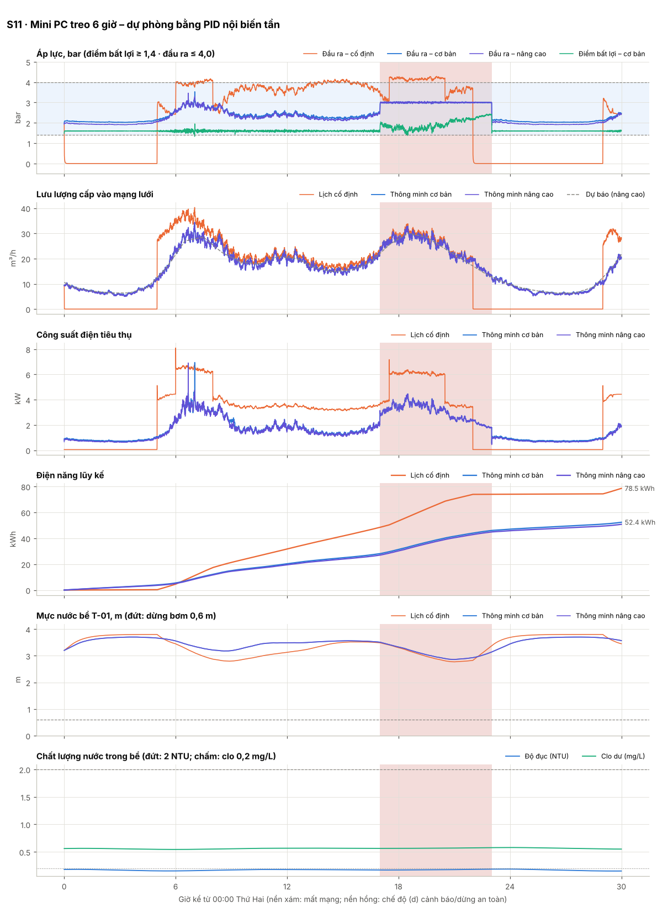

Diễn biến chính (mức nâng cao)

- `N1 06:40` Ghép bơm thứ hai sớm theo dự báo
- `N1 08:54` Tách bơm – một bơm đủ đáp ứng
- `N1 17:00` Mini PC (edge gateway) ngừng hoạt động – mất thu thập, điều khiển, an toàn mềm và truyền thông
- `N1 17:00` Rơ-le watchdog nhả sau 5 s – biến tần P-01 chuyển PID nội giữ 3.0 bar theo PT-101, bơm còn lại dừng
- `N1 23:00` BÁO ĐỘNG [GW_WATCHDOG] Mini PC ngừng 360 phút (watchdog phát hiện) – biến tần P-01 chạy PID nội giữ 3.0 bar; đã khởi động lại
- `N1 23:00` Mini PC khởi động lại: nạp kịch bản v3, mô hình dự báo và 0 bản ghi đệm từ ổ SSD – theo dõi 60 s trước khi tiếp quản
- `N1 23:00` Khôi phục kết nối sau 0.0 phút – chế độ (c) đồng bộ: gửi bản tin chào, 0 bản ghi đệm
- `N1 23:00` Hiệu chỉnh đồng hồ gateway: lệch -1.00 s sau thời gian mất mạng
- `N1 23:00` Đồng bộ hoàn tất sau 4 s – trở lại chế độ (a) bình thường
- `N1 23:01` Mini PC tiếp quản điều khiển (không xung) – biến tần thôi chạy PID nội
- `N2 05:59` Luân phiên bơm: P-01 → P-02 (đủ 24 h chạy)

## S12 · Điều khiển bơm từ xa và tại chỗ (HMI) – quyền điều khiển, liên động

09:30 kỹ thuật viên tới trạm, lấy quyền điều khiển TAY trên HMI; lệnh từ xa lúc 09:36 bị từ chối vì quyền tại chỗ ưu tiên. 09:45 đóng van MV-02 khi bơm đang chạy: liên động dừng bơm, 09:50 mở lại van thì bơm chạy tiếp. 10:00 đặt P-01 50 Hz: lớp an toàn giới hạn tần số khi áp tới 4,0 bar. 10:30 trả về tự động. 13:00 điều độ viên ở trung tâm lấy quyền TAY từ xa, chạy thử bơm dự phòng P-02 rồi dừng; 13:30 mất 4G khi đang điều khiển từ xa: gateway tự trả về TỰ ĐỘNG. 16:00 trung tâm lại lấy quyền TAY nhưng không thao tác gì: hết thời hạn 30 phút, gateway tự trả về tự động.

| Chỉ số | Lịch cố định | Thông minh – cơ bản (ngưỡng) | Thông minh – nâng cao (dự báo) |
|---|---:|---:|---:|
| Điện năng tiêu thụ (kWh) | 53,4 | 32,1 | 31,0 |
| Tiết kiệm so với lịch cố định | – | 39,9 % | 42,0 % |
| Suất điện năng (kWh/m³ cấp vào mạng) | 0,172 | 0,105 | 0,102 |
| Nước cấp vào mạng (m³) | 310 | 304 | 303 |
| Rò rỉ trên mạng (m³) | 35,0 | 28,9 | 27,8 |
| Thiếu nước thực sự – bồn mái cạn (m³) | 0,0 | 0,0 | 0,0 |
| Áp lực ngoài dải – tổng (phút) | 507 | 13 | 24 |
|   · áp điểm bất lợi < 1,4 bar (phút) | 355 | 13 | 24 |
|   · áp đầu ra > 4,0 bar (phút) | 152 | 0 | 0 |
| Thời gian đạt dải áp (%) | 53,0 | 98,8 | 97,8 |
| Áp đầu ra lớn nhất (bar) | 4,27 | 4,00 | 4,00 |
| Số đợt cấp nước không đạt QCVN | 0 | 0 | 0 |
| Lượng nước không đạt QCVN đã cấp (m³) | 0,0 | 0,0 | 0,0 |
| Số lần khởi động bơm (P-01 + P-02) | 3 (1 + 2) | 3 (1 + 2) | 3 (1 + 2) |
| Giờ chạy P-01 / P-02 (h) | 13,0 / 2,5 | 17,9 / 2,4 | 17,9 / 2,5 |
| Thời gian bơm chạy khô (phút) | 0,0 | 0,0 | 0,0 |
| Thời gian phát hiện sự cố | – | – | – |

| Chỉ số truyền thông & đồng bộ | Cơ bản | Nâng cao |
|---|---:|---:|
| Thời gian mất mạng (phút) | 29 | 29 |
| Bản ghi đo xa sinh ra | 6479 | 6479 |
| Độ đầy bộ đệm lớn nhất (%) | 4,2 | 4,2 |
| Số lần nén bộ đệm | 0 | 0 |
| Bản ghi bị mất do tràn | 0 | 0 |
| Độ đầy đủ dữ liệu tại máy chủ (%) | 100,0 | 100,0 |
| Bản ghi đến muộn (phát lại sau đồng bộ) | 176 | 176 |
| Số xung đột tham số đã giải quyết | 0 | 0 |
| SMS dự phòng đã gửi | 0 | 0 |
| Dữ liệu lên / xuống (kB) | 1964 / 617 | 1964 / 617 |
| Sai số dự báo MAPE (%) | 5,3 | 5,5 |

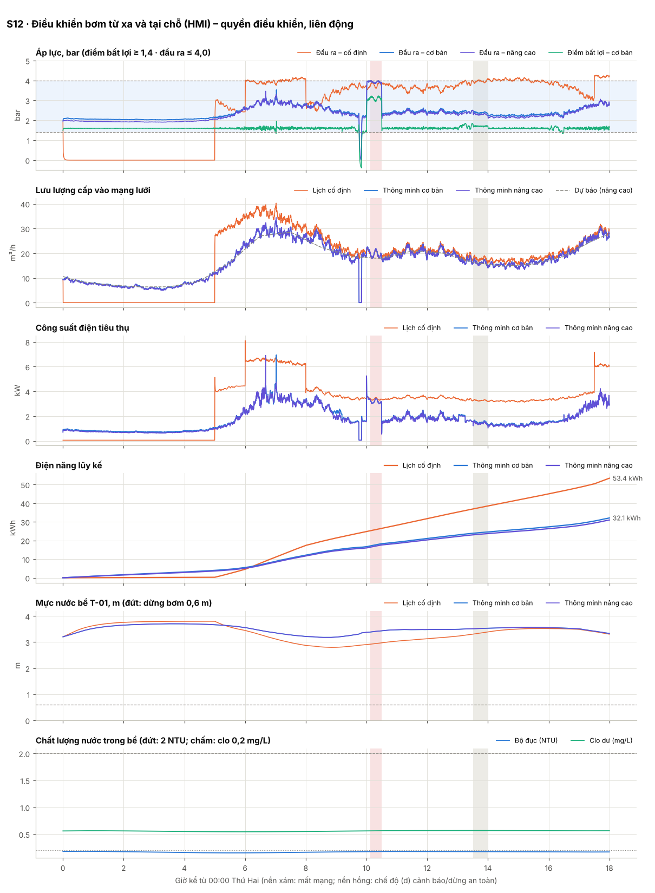

Diễn biến chính (mức nâng cao)

- `N1 06:40` Ghép bơm thứ hai sớm theo dự báo
- `N1 08:54` Tách bơm – một bơm đủ đáp ứng
- `N1 09:30` BÁO ĐỘNG [MANUAL_MODE] Trạm ở chế độ TAY – điều khiển tại chỗ (HMI); kịch bản tự động tạm ngưng, lớp an toàn vẫn hoạt động
- `N1 09:30` HMI tại trạm – set_mode: chuyển sang chế độ TAY tại chỗ (HMI)
- `N1 09:36` Lệnh từ xa pump_speed (trực tuyến): TỪ CHỐI – trạm đang điều khiển TẠI CHỖ – quyền HMI tại trạm ưu tiên, từ chối lệnh từ xa
- `N1 09:45` HMI tại trạm – valve: đóng van MV-02
- `N1 09:45` Ưu tiên an toàn: chặn lệnh chạy 1 bơm của người vận hành (chờ van MV-02 mở hết (trình tự: mở van trước, chạy bơm sau))
- `N1 09:50` HMI tại trạm – valve: mở van MV-02
- `N1 10:00` HMI tại trạm – pump_speed: đặt tần số P-01 = 50.0 Hz
- `N1 10:30` Kết thúc chế độ TAY tại chỗ (HMI) sau 60 phút (lệnh tại chỗ (HMI)) – kịch bản v3 tiếp quản
- `N1 10:30` HMI tại trạm – set_mode: trở về TỰ ĐỘNG theo kịch bản v3
- `N1 13:00` BÁO ĐỘNG [MANUAL_MODE] Trạm ở chế độ TAY – điều khiển từ xa (trung tâm); kịch bản tự động tạm ngưng, lớp an toàn vẫn hoạt động
- `N1 13:00` Lệnh từ xa set_mode (trực tuyến): chuyển sang chế độ TAY từ xa (trung tâm), quyền có hạn 30 phút, tự trở về tự động khi mất kết nối
- `N1 13:02` Lệnh từ xa pump_start (trực tuyến): chạy P-02 ở 30.0 Hz
- `N1 13:15` Lệnh từ xa pump_stop (trực tuyến): dừng P-02
- `N1 13:18` Lệnh từ xa pump_speed (trực tuyến): đặt tần số P-01 = 38.0 Hz
- `N1 13:30` Mất kết nối máy chủ > 60 s – chuyển chế độ (b) tự vận hành bằng kịch bản v3 đã lưu
- `N1 13:30` BÁO ĐỘNG [COMMS_OFFLINE] Mất kết nối máy chủ điều hành
- `N1 13:30` Mất kết nối khi đang điều khiển TAY từ xa – tự trở về TỰ ĐỘNG (không để trạm chạy theo lệnh cũ)
- `N1 13:30` Kết thúc chế độ TAY từ xa (trung tâm) sau 31 phút (mất kết nối) – kịch bản v3 tiếp quản
- `N1 14:00` Khôi phục kết nối sau 29.1 phút – chế độ (c) đồng bộ: gửi bản tin chào, 181 bản ghi đệm
- `N1 14:00` Hiệu chỉnh đồng hồ gateway: lệch -0.93 s sau thời gian mất mạng
- `N1 14:00` Đồng bộ hoàn tất sau 11 s – trở lại chế độ (a) bình thường
- `N1 16:00` BÁO ĐỘNG [MANUAL_MODE] Trạm ở chế độ TAY – điều khiển từ xa (trung tâm); kịch bản tự động tạm ngưng, lớp an toàn vẫn hoạt động
- `N1 16:00` Lệnh từ xa set_mode (trực tuyến): chuyển sang chế độ TAY từ xa (trung tâm), quyền có hạn 30 phút, tự trở về tự động khi mất kết nối
- `N1 16:30` Kết thúc chế độ TAY từ xa (trung tâm) sau 30 phút (hết thời hạn quyền điều khiển từ xa) – kịch bản v3 tiếp quản

## S13 · pH nước nguồn 9,5 trong 8 giờ – giá trị của máy đo pH

06:00 nước nguồn có pH 9,5 kéo dài 8 giờ (sự cố châm hóa chất ở nhà máy nước). Có AIT-203: dừng an toàn khi pH trong bể vượt 8,5 quá 120 s; 14:30 xả bể, 16:30 đặt lại khi nước đã đạt. Tắt AIT-203 ở tab Thiết bị (hoặc python -m trambom run S13 --off AIT-203) để thấy nước pH cao vẫn được cấp ra mạng.

| Chỉ số | Lịch cố định | Thông minh – cơ bản (ngưỡng) | Thông minh – nâng cao (dự báo) |
|---|---:|---:|---:|
| Điện năng tiêu thụ (kWh) | 74,0 | 46,4 | 47,4 |
| Tiết kiệm so với lịch cố định | – | 37,4 % | 36,0 % |
| Suất điện năng (kWh/m³ cấp vào mạng) | 0,178 | 0,123 | 0,124 |
| Nước cấp vào mạng (m³) | 415 | 377 | 384 |
| Rò rỉ trên mạng (m³) | 46,7 | 28,6 | 28,1 |
| Thiếu nước thực sự – bồn mái cạn (m³) | 0,0 | 0,0 | 0,0 |
| Áp lực ngoài dải – tổng (phút) | 777 | 539 | 516 |
|   · áp điểm bất lợi < 1,4 bar (phút) | 475 | 539 | 516 |
|   · áp đầu ra > 4,0 bar (phút) | 302 | 0 | 0 |
| Thời gian đạt dải áp (%) | 46,0 | 62,6 | 64,2 |
| Áp đầu ra lớn nhất (bar) | 4,29 | 3,66 | 3,97 |
| Số đợt cấp nước không đạt QCVN | 1 | 1 | 1 |
| Lượng nước không đạt QCVN đã cấp (m³) | 97,7 | 1,2 | 1,2 |
| Số lần khởi động bơm (P-01 + P-02) | 3 (1 + 2) | 6 (2 + 4) | 5 (2 + 3) |
| Giờ chạy P-01 / P-02 (h) | 17,0 / 5,0 | 17,8 / 7,7 | 17,5 / 7,6 |
| Thời gian bơm chạy khô (phút) | 0,0 | 0,0 | 0,0 |
| Thời gian phát hiện sự cố | không phát hiện | 193 phút | 193 phút |

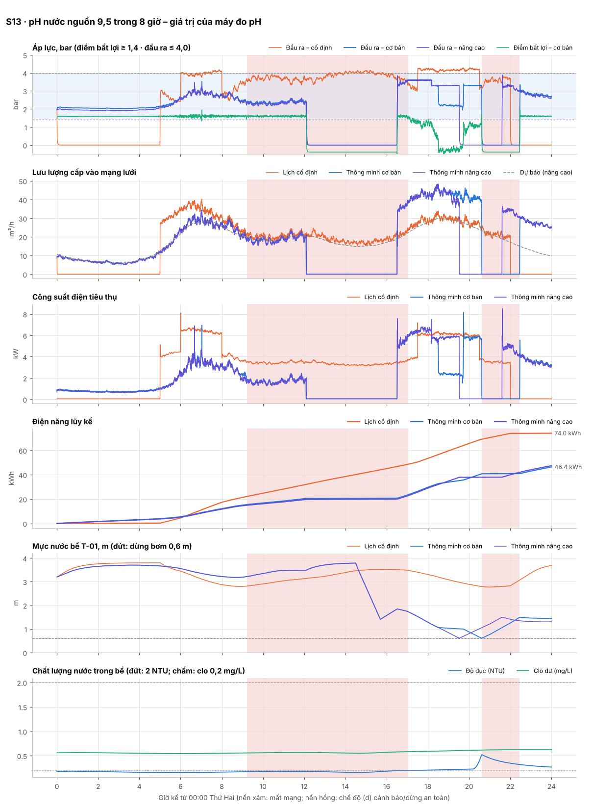

Diễn biến chính (mức nâng cao)

- `N1 06:40` Ghép bơm thứ hai sớm theo dự báo
- `N1 08:54` Tách bơm – một bơm đủ đáp ứng
- `N1 09:12` BÁO ĐỘNG [PH_WARN] pH 8.01  ngoài dải làm việc
- `N1 12:06` BÁO ĐỘNG [PH_TRIP] pH vượt ngưỡng QCVN (8.51 ) quá 120 s
- `N1 12:06` BÁO ĐỘNG [SAFE_STOP] DỪNG AN TOÀN: pH không đạt – dừng bơm, đóng van MV-02
- `N1 12:06` Ưu tiên an toàn: chặn lệnh chạy 1 bơm của kịch bản (dừng an toàn do pH)
- `N1 14:30` Lệnh từ xa flush_tank (trực tuyến): mở van xả VX-01 tới mức 1.4 m
- `N1 15:41` Xả bể kết thúc ở mức 1.40 m
- `N1 16:30` Kết thúc dừng an toàn (lệnh đặt lại) – mở van đầu ra, chạy lại bơm
- `N1 16:30` Lệnh từ xa reset_safe_stop (trực tuyến): Đã đặt lại dừng an toàn
- `N1 16:30` Cấp nước trở lại sau 264 phút ngừng – bồn mái nạp bù, tạm dừng học dự báo và phát hiện bất thường 6.6 h
- `N1 16:31` Ghép bơm thứ hai (bơm chính đã max tần số)
- `N1 17:22` BÁO ĐỘNG [TTE_LOW] Dự báo bể cạn sau 5.9 h – chủ động giảm áp
- `N1 18:10` BÁO ĐỘNG [LEVEL_LOW] Mức bể thấp (< 1.2 m) – giảm áp tiết kiệm nước
- `N1 19:31` BÁO ĐỘNG [LEVEL_STOP] Mức bể < 0.6 m – kịch bản dừng bơm chống chạy khô
- `N1 21:35` Mức bể hồi phục > 1.5 m – cho phép chạy bơm lại
- `N1 21:35` Cấp nước trở lại sau 124 phút ngừng – bồn mái nạp bù, tạm dừng học dự báo và phát hiện bất thường 3.1 h
- `N1 21:36` Ghép bơm thứ hai (bơm chính đã max tần số)

